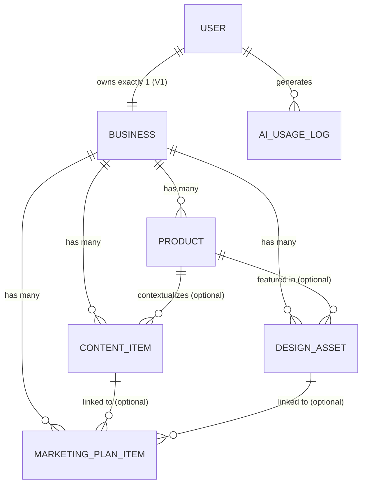
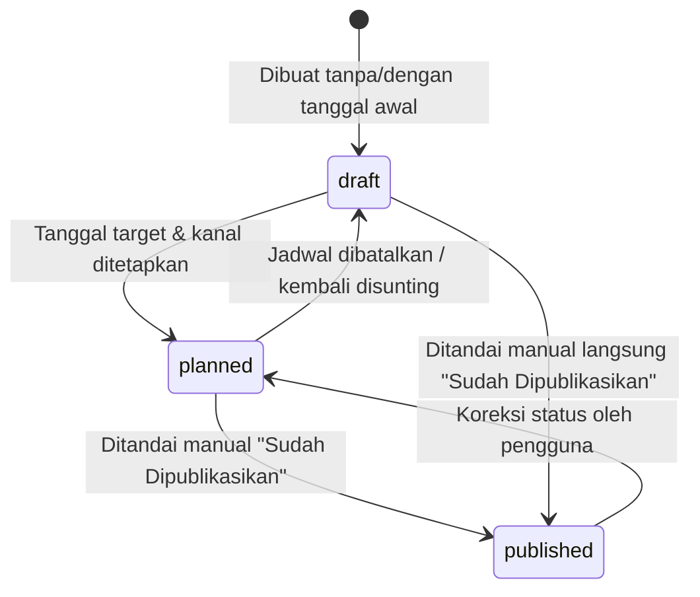

# Product Requirements Document (PRD) — DagangAI

> **Status:** Draft v1.0 (Ready for Review)  
> **Document Type:** Product Requirements Document (PRD)  
> **Product:** DagangAI  
> **Release Target:** V1.0 — Competition MVP  
> **Version:** 1.0.0  
> **Last Updated:** 27 November 2026  
> **Source Document:** [product-discovery.md](./product-discovery.md) (v0.1.0)  
> **Document Purpose:** Menerjemahkan konsep, keputusan, prinsip, dan batasan dari tahap Product Discovery menjadi spesifikasi kebutuhan produk yang terukur, dapat diuji, dan siap menjadi dasar penyusunan desain UI/UX, arsitektur teknis, serta implementasi V1.0.

---

## Daftar Isi

1. [Ringkasan Eksekutif](#1-ringkasan-eksekutif)
2. [Tujuan, Non-Goals, dan Metrik Keberhasilan](#2-tujuan-non-goals-dan-metrik-keberhasilan)
3. [Penyelarasan Keputusan Discovery ke V1.0](#3-penyelarasan-keputusan-discovery-ke-v10)
4. [Target Pengguna, Segmen, dan Peran Akses](#4-target-pengguna-segmen-dan-peran-akses)
5. [Ruang Lingkup Produk dan Prioritas Fitur](#5-ruang-lingkup-produk-dan-prioritas-fitur)
6. [Arsitektur Informasi dan Alur Pengguna Utama](#6-arsitektur-informasi-dan-alur-pengguna-utama)
7. [Aturan Bisnis (Business Rules)](#7-aturan-bisnis-business-rules)
8. [Kebutuhan Fungsional (Functional Requirements)](#8-kebutuhan-fungsional-functional-requirements)
9. [User Stories dan Acceptance Criteria](#9-user-stories-dan-acceptance-criteria)
10. [Spesifikasi Pengalaman AI dan Responsible AI](#10-spesifikasi-pengalaman-ai-dan-responsible-ai)
11. [Model Data Konseptual dan Siklus Hidup Materi](#11-model-data-konseptual-dan-siklus-hidup-materi)
12. [Kebutuhan Nonfungsional (Non-Functional Requirements)](#12-kebutuhan-nonfungsional-non-functional-requirements)
13. [Kebutuhan Operasional, Kuota AI, dan Pengendalian Biaya](#13-kebutuhan-operasional-kuota-ai-dan-pengendalian-biaya)
14. [Risiko, Ketergantungan, dan Rencana Mitigasi](#14-risiko-ketergantungan-dan-rencana-mitigasi)
15. [Asumsi, Pertanyaan Terbuka Lanjutan, dan Kriteria Siap Rilis](#15-asumsi-pertanyaan-terbuka-lanjutan-dan-kriteria-siap-rilis)

---

# 1. Ringkasan Eksekutif

## 1.1 Gambaran Produk

**DagangAI** adalah *AI-powered digital marketing workspace* berbasis web responsif yang membantu pelaku Usaha Mikro, Kecil, dan Menengah (UMKM) serta pelaku ekonomi kreatif mengelola informasi bisnis dan produk, menghasilkan materi pemasaran teks yang kontekstual, menyusun visual promosi sederhana berbasis template, serta merencanakan dan memantau aktivitas pemasaran dalam satu platform terpadu.

Berbeda dari chatbot umum atau generator caption yang berdiri sendiri, DagangAI menghubungkan **konteks bisnis dan katalog produk yang tersimpan** secara langsung ke seluruh alur kerja pemasaran. Dengan pendekatan ini, pengguna tidak perlu mengulang penjelasan tentang usahanya setiap kali membuat materi promosi, dan hasil AI menjadi lebih selaras dengan karakter merek serta fakta produk yang diberikan pengguna.

## 1.2 Pernyataan Masalah Utama (Fokus V1.0)

Pelaku UMKM dan ekonomi kreatif menghadapi tiga hambatan saling terkait dalam pemasaran digital: kesulitan menulis materi promosi yang menarik dan konsisten, kesulitan membuat materi visual tanpa keahlian desain, serta kesulitan menjaga keteraturan rencana konten.

Untuk **V1.0 (Competition MVP)**, DagangAI memusatkan penyelesaian pada:
1. **Masalah Primer:** Kesulitan membuat materi tulisan pemasaran (*caption*, deskripsi produk/layanan, slogan, CTA, dan ide konten) yang relevan dengan identitas merek dan fakta produk tanpa harus menguasai teknik *prompting* atau *copywriting*.
2. **Masalah Pendukung Terintegrasi:** Kesulitan menyiapkan materi visual promosi dasar yang konsisten secara cepat di desktop maupun mobile, serta kesulitan menyimpan, mengorganisasi, dan menjadwalkan materi yang telah dibuat agar mudah ditemukan dan digunakan kembali.

## 1.3 Proposisi Nilai (Value Proposition)

> Bagi pelaku UMKM dan ekonomi kreatif yang memiliki keterbatasan waktu serta keahlian pemasaran digital, **DagangAI** menyediakan satu ruang kerja web terintegrasi yang memadukan profil bisnis, data produk, pembuatan materi pemasaran berbasis AI, template visual promosi ramah mobile, dan perencana konten — sehingga pengguna dapat menghasilkan, menyunting, menyimpan, dan menjadwalkan materi promosi yang relevan dengan bisnis mereka secara jauh lebih cepat dan terarah.

## 1.4 Prinsip Produk

Seluruh keputusan desain dan implementasi V1.0 wajib mematuhi lima prinsip dari tahap discovery:
1. **Context-Driven:** AI selalu memanfaatkan profil bisnis, data produk, target pelanggan, dan gaya komunikasi pengguna sebagai sumber konteks utama.
2. **Integrated Workflow:** Data bisnis, produk, generasi konten, visual promosi, rencana pemasaran, dan ringkasan aktivitas saling terhubung dalam satu ekosistem kerja.
3. **Accessible:** Alur dan bahasa antarmuka dirancang agar dipahami pengguna tanpa latar belakang pemasaran digital, desain grafis, maupun *prompt engineering*.
4. **Actionable Output:** Setiap keluaran AI harus dapat ditinjau, diedit, disalin/diunduh, disimpan, dan dihubungkan ke produk serta rencana pemasaran.
5. **Responsible AI:** Sistem dilarang mengarang klaim produk, sertifikasi, manfaat kesehatan, harga, stok, atau diskon yang tidak diberikan pengguna, serta selalu menempatkan pengguna sebagai peninjau akhir (*human-in-the-loop*).

---

# 2. Tujuan, Non-Goals, dan Metrik Keberhasilan

## 2.1 Tujuan Produk V1.0 (Product Goals)

| ID | Tujuan Produk | Indikator Pencapaian Tingkat Produk |
|---|---|---|
| **G-01** | Mempercepat pembuatan materi pemasaran berbasis konteks bisnis | Pengguna dapat membuat materi promosi pertama dalam satu sesi onboarding tanpa menulis prompt panjang dari nol. |
| **G-02** | Menghasilkan materi yang relevan dan akurat terhadap fakta usaha | Hasil AI merefleksikan informasi bisnis/produk yang tersimpan dan bebas dari klaim faktual rekaan. |
| **G-03** | Menyatukan alur pemasaran dalam satu workspace responsif | Pengguna dapat berpindah mulus dari pengelolaan produk → pembuatan teks AI → template visual → penjadwalan konten di desktop maupun mobile. |
| **G-04** | Memudahkan penyimpanan dan penggunaan kembali materi | Seluruh materi tersimpan, dapat dicari/difilter berdasarkan produk atau status, dan mudah disalin/diunduh untuk publikasi manual. |
| **G-05** | Menjaga operasional layanan AI tetap terkendali selama kompetisi | Layanan tersedia secara gratis selama kompetisi tanpa melampaui anggaran/kuota AI berkat pembatasan dan pemantauan pemakaian. |

## 2.2 Non-Goals (Eksplisit di Luar Tujuan V1.0)

1. **Tidak menjanjikan peningkatan penjualan, jangkauan, atau konversi otomatis.** DagangAI membantu proses produksi dan pengelolaan materi pemasaran; hasil penjualan dipengaruhi banyak faktor di luar platform.
2. **Bukan platform publikasi otomatis media sosial.** V1.0 tidak memublikasikan konten secara langsung ke Instagram, TikTok, Facebook, WhatsApp, atau marketplace; pengguna menyalin teks atau mengunduh visual untuk dipublikasikan secara manual.
3. **Bukan alat analitik performa media sosial eksternal.** V1.0 tidak menarik metrik *reach*, *impression*, *engagement*, klik, atau omzet dari kanal eksternal.
4. **Bukan aplikasi desain grafis penuh atau generator gambar AI.** V1.0 tidak menggantikan editor desain vektor kompleks maupun menyediakan generasi gambar berbasis AI (*text-to-image*).
5. **Bukan platform kolaborasi tim atau manajemen agensi multi-bisnis.** V1.0 dirancang khusus untuk 1 akun mengelola tepat 1 bisnis.
6. **Tidak mencakup monetisasi, langganan, atau pembayaran.** Platform gratis selama periode kompetisi.

## 2.3 Metrik Keberhasilan (Success Metrics)

Target angka bersifat baseline awal untuk evaluasi selama periode uji coba dan kompetisi (dapat dikalibrasi setelah pengujian pengguna awal):

| Area | Metrik | Definisi Operasional | Target Awal V1.0 |
|---|---|---|---|
| **Activation** | Onboarding Completion Rate | % akun baru yang melengkapi profil bisnis dan menambahkan minimal 1 produk/layanan | ≥ 70% |
| **Time to Value** | Time to First Saved Content | Waktu median dari registrasi hingga pengguna menyimpan materi AI pertama | ≤ 5 menit |
| **Core Workflow** | Content Save Rate | % sesi generasi AI yang berujung pada aksi simpan (*save*) atau salin (*copy*) materi | ≥ 50% |
| **Workspace Integration** | Cross-Module Adoption | % pengguna aktif yang memanfaatkan ≥ 2 modul (mis. AI Content Studio + Design Studio atau Marketing Planner) | ≥ 40% |
| **AI Quality** | User Relevance Rating | Rata-rata penilaian pengguna (skala 1–5 atau jempol naik/turun) terhadap relevansi hasil AI | ≥ 4.0 / 5.0 (atau ≥ 80% positif) |
| **Responsible AI** | Hallucination Report Rate | % output yang ditandai pengguna mengandung klaim faktual keliru/rekaan | < 5% |
| **Retention** | 7-Day Return Rate | % pengguna teraktivasi yang kembali membuat atau mengelola materi dalam 7 hari | ≥ 25% |
| **Reliability** | AI Request Success Rate | % permintaan generasi AI yang berhasil tanpa error teknis (tidak termasuk penolakan kuota) | ≥ 97% |

---

# 3. Penyelarasan Keputusan Discovery ke V1.0

Tabel berikut memetakan seluruh item pada *Current Decision Log* di [product-discovery.md](./product-discovery.md) (D-01 s.d. D-14) menjadi ketetapan ruang lingkup V1.0 agar tidak terjadi ambiguitas saat implementasi.

| ID | Topik Keputusan | Status di Discovery | Ketetapan untuk PRD V1.0 | Rasional & Catatan |
|---|---|---|---|---|
| **D-01** | Nama produk | Confirmed | **DagangAI** | Mengikuti keputusan discovery. |
| **D-02** | Target pasar | Confirmed | **UMKM & pelaku ekonomi kreatif** | Mengikuti keputusan discovery. |
| **D-03** | Integrasi AI | Confirmed | **AI terintegrasi penuh** dengan konteks bisnis & produk | Inti diferensiasi produk. |
| **D-04** | Aturan kepemilikan | Confirmed (V1) | **1 akun = tepat 1 bisnis** | Menyederhanakan arsitektur konteks dan keamanan data V1. |
| **D-05** | Platform | Confirmed | **Web responsif (desktop & mobile)** | Pendekatan *mobile-friendly* agar dapat dipakai langsung dari ponsel pelaku UMKM. |
| **D-06** | Model bisnis | Confirmed | **Gratis selama periode kompetisi** | Tanpa billing, langganan, atau payment gateway. |
| **D-07** | Segmen prioritas | Pending | **Terbuka untuk semua kategori, dengan preset & optimasi awal untuk F&B, Fashion & Kerajinan, dan Jasa Lokal** | Mengurangi risiko R-01 (terlalu generik) tanpa memblokir segmen ekraf lain seperti kecantikan, fotografi/videografi, atau desain. |
| **D-08** | Masalah utama MVP | Pending | **Primer: Pembuatan konten pemasaran kontekstual**; **Sekunder terintegrasi: Visual berbasis template + Perencana konten sederhana** | Menjawab nilai *integrated workspace* sekaligus menjaga ruang lingkup tetap realistis untuk tenggat kompetisi (mitigasi R-02). |
| **D-09** | Kemampuan AI V1 | Pending | **Teks pemasaran kontekstual (P0), iterasi/refine cepat (P0), saran ide/rencana konten (P1), pengisian teks otomatis ke template visual (P1)** | Memberikan dampak tertinggi dengan biaya token terukur. |
| **D-10** | Model interaksi AI | Pending | **Form-First Terstruktur + Iterative Quick Refine** | Formulir terstruktur memudahkan pengguna pemula (minim *blank-page problem*), ditambah panel revisi cepat berbasis instruksi singkat agar tetap fleksibel. |
| **D-11** | Generasi gambar AI | Pending | **Ditunda (Out of Scope V1)**; diganti **Template Desain Promosi Sederhana** | Memitigasi biaya tinggi, latensi, inkonsistensi tipografi lokal, dan kompleksitas mobile (mitigasi R-03 & R-04). |
| **D-12** | Kuota & batas AI | Pending | **Kuota harian per akun + rate limit per menit (configurable)** dengan transparansi sisa kuota di UI | Melindungi anggaran kompetisi dan stabilitas layanan (mitigasi R-06 & R-10). |
| **D-13** | Kolaborasi tim | Pending | **Out of Scope V1** (hanya single Business Owner per bisnis) | Konsisten dengan D-04 dan menghindari kompleksitas RBAC tim di V1. |
| **D-14** | Analytics eksternal | Pending | **Out of Scope V1**; V1 hanya menyediakan **Ringkasan Aktivitas Internal** | Mencegah metrik menyesatkan dan ketergantungan API pihak ketiga (mitigasi R-05). |

---

# 4. Target Pengguna, Segmen, dan Peran Akses

## 4.1 Segmen Pengguna

Platform mendukung seluruh kategori UMKM dan ekonomi kreatif melalui pilihan kategori bisnis, dengan **preset panduan, contoh input, dan template awal** yang dioptimalkan untuk 3 segmen prioritas V1.0:

| Prioritas | Segmen | Kebutuhan Utama yang Didukung V1.0 |
|---|---|---|
| **Prioritas Utama (Preset Optimal)** | **Makanan & Minuman (F&B)** | Caption promosi menu harian/musiman, deskripsi produk makanan/minuman, poster promo harga/paket, ide konten mingguan. |
| **Prioritas Utama (Preset Optimal)** | **Fashion & Kerajinan** | Deskripsi katalog produk (bahan, ukuran, keunggulan), storytelling merek, banner koleksi baru, CTA pemesanan. |
| **Prioritas Utama (Preset Optimal)** | **Jasa Lokal** | Penawaran layanan, slogan dan profil singkat usaha, materi promosi penawaran jasa, CTA konsultasi/booking. |
| **Didukung Penuh (Kategori Umum)** | **Kecantikan & Perawatan Diri, Fotografi & Videografi, Desain & Produk Kreatif, Lainnya** | Seluruh modul inti tetap dapat digunakan sepenuhnya dengan pengisian konteks bisnis dan produk secara fleksibel. |

## 4.2 Provisional Personas

> **Catatan Discovery:** Persona berikut merupakan *provisional personas* sebagai panduan perancangan alur V1.0 dan tetap perlu diperbarui berdasarkan temuan wawancara/pengujian pengguna selama periode kompetisi.

### Persona 1 — Pemilik Usaha F&B Mikro (Mobile-First)
- **Profil:** Pemilik usaha kuliner rumahan/kedai kecil yang merangkap produksi, penjualan, dan promosi.
- **Perangkat Utama:** Smartphone (80%) dan laptop sesekali.
- **Hambatan:** Bingung menulis caption yang tidak monoton; tidak punya waktu mendesain poster dari awal; sering lupa merencanakan konten sebelum momen promo.
- **Kebutuhan:** Isi data usaha sekali, pilih menu, langsung dapat 2–3 pilihan caption + poster promo sederhana dalam hitungan menit.

### Persona 2 — Pelaku Ekonomi Kreatif / Brand Fashion & Craft (Desktop & Mobile)
- **Profil:** Pemilik merek kerajinan/fashion lokal atau penyedia jasa kreatif yang peduli pada konsistensi gaya bahasa dan estetika merek.
- **Perangkat Utama:** Laptop/desktop untuk perencanaan, smartphone untuk pengecekan cepat.
- **Hambatan:** Output AI umum terasa kaku dan tidak mencerminkan karakter merek; materi promosi tersebar di berbagai catatan dan folder.
- **Kebutuhan:** Menyimpan identitas komunikasi merek (*brand voice*), menghasilkan variasi copy sesuai kanal (Instagram, WhatsApp, katalog), dan menyusun kalender konten terorganisasi.

## 4.3 Peran Pengguna dan Hak Akses (V1.0)

| Peran | Deskripsi | Hak Akses Utama di V1.0 |
|---|---|---|
| **Guest** | Pengunjung belum masuk | Melihat halaman landing/informasi DagangAI, mengakses halaman registrasi dan login. |
| **Business Owner** | Pengguna terautentikasi (1 akun = 1 bisnis) | Mengelola profil akun, mengelola tepat 1 profil bisnis, CRUD produk/layanan, menggunakan AI Content Studio, menggunakan AI Design Studio (template), mengelola Content Library & Marketing Planner, melihat Marketing Activity Summary & sisa kuota AI, memberikan rating/umpan balik hasil AI. |
| **Platform Admin** | Pengelola operasional kompetisi (internal) | Melihat ringkasan pemakaian AI agregat, memantau error/kegagalan layanan AI, mengatur parameter kuota harian & rate limit global, menonaktifkan akun yang terbukti menyalahgunakan sistem. *(Tidak membaca/mengubah isi konten bisnis kecuali untuk kebutuhan dukungan/audit sesuai kebijakan privasi).* |

---

# 5. Ruang Lingkup Produk dan Prioritas Fitur

Prioritas menggunakan klasifikasi:
- **P0 (Must-Have MVP):** Wajib selesai dan berfungsi stabil agar V1.0 dapat dirilis dan didemonstrasikan.
- **P1 (Should-Have MVP):** Sangat bernilai untuk memperkuat posisi *integrated workspace*; masuk rilis V1.0 selama tidak mengganggu stabilitas P0.
- **P2 (Nice-to-Have / Stretch):** Dapat ditambahkan jika jadwal dan anggaran masih mencukupi.
- **Out of Scope (V2+):** Eksplisit tidak dikerjakan pada V1.0.

## 5.1 Matriks Ruang Lingkup V1.0

| Modul | Fitur / Kapabilitas | Prioritas | Status V1.0 |
|---|---|---|---|
| **M1. Autentikasi & Onboarding** | Registrasi, login, logout, reset kata sandi, dan alur onboarding pembuatan profil bisnis awal | **P0** | In Scope |
| **M2. Business Management** | Profil bisnis (nama, kategori, deskripsi, target pelanggan, keunggulan, *brand voice*/gaya komunikasi, warna/logo merek) sebagai konteks AI | **P0** | In Scope |
| **M3. Product Management** | CRUD produk/layanan (nama, kategori, deskripsi, harga opsional, keunggulan, status ketersediaan, unggah foto produk) | **P0** | In Scope |
| **M4. AI Content Studio** | Generasi teks pemasaran berbasis konteks (caption, deskripsi produk, slogan/headline, CTA, ide konten, variasi gaya), pemilihan kanal, *quick refine*, edit manual, simpan ke pustaka, salin cepat, rating kualitas | **P0** | In Scope |
| **M5. Content Library** | Daftar seluruh materi tersimpan (teks & visual), pencarian, filter berdasarkan produk/jenis/status, edit ulang, duplikasi, hapus | **P0** | In Scope |
| **M6. AI Design Studio (Template)** | Pemilihan template visual promosi (rasio feed 1:1, story 9:16, banner 16:9), *smart fill* dari data produk & teks AI, ubah teks/warna/foto ramah mobile (tanpa drag-and-drop wajib), simpan & unduh PNG/JPG | **P1** | In Scope |
| **M7. Marketing Planner** | Daftar & tampilan kalender konten bulanan/mingguan, penjadwalan tanggal target, status materi (`draft`, `planned`, `published`), penghubungan ke produk/kampanye, saran ide rencana konten dari AI | **P1** | In Scope |
| **M8. Marketing Activity Summary** | Ringkasan aktivitas internal (total materi dibuat/disimpan, distribusi status konten, produk paling sering dipromosikan, aktivitas terbaru, indikator pemakaian kuota AI) | **P1** | In Scope |
| **M9. Operational Controls (Admin)** | Konfigurasi kuota AI & rate limiting, pemantauan agregat permintaan/error AI, pencatatan log penggunaan AI | **P1** | In Scope |
| **Ekspor Massal / Paket Kampanye** | Ekspor ringkasan rencana konten ke CSV/PDF | **P2** | Stretch |

## 5.2 Fitur Eksplisit di Luar Ruang Lingkup V1.0 (Out of Scope / Future Phases)

- Generasi gambar berbasis AI (*AI text-to-image / image editing*).
- Kolaborasi tim / multi-pengguna dalam satu bisnis (undang anggota, manajemen peran tim).
- Pengelolaan multi-bisnis dalam satu akun.
- Publikasi otomatis / integrasi API langsung ke Instagram, TikTok, Facebook, WhatsApp Business, atau marketplace (Shopee, Tokopedia, dll.).
- Integrasi analitik performa eksternal (*reach*, *impression*, *engagement*, klik, konversi, penjualan).
- AI customer service / chatbot pelanggan eksternal.
- Prediksi penjualan atau proyeksi pendapatan berbasis AI.
- Sistem langganan, paket berbayar, faktur, dan *payment gateway*.
- Aplikasi mobile native (Android/iOS) terpisah (V1.0 adalah web responsif).

---

# 6. Arsitektur Informasi dan Alur Pengguna Utama

## 6.1 Peta Navigasi Aplikasi (Authenticated Workspace)

Navigasi dirancang konsisten antara **sidebar (desktop)** dan **bottom navigation / drawer menu (mobile)**:

1. **Dashboard (Beranda)** — Ringkasan aktivitas internal, pintasan cepat (*Buat Konten*, *Buat Visual*, *Tambah Produk*), jadwal konten terdekat, dan status kelengkapan profil bisnis + sisa kuota AI.
2. **Bisnis & Produk**
   - *Profil Bisnis* (identitas, target pelanggan, gaya komunikasi, aset merek)
   - *Produk & Layanan* (katalog produk/layanan dan foto)
3. **AI Content Studio** — Form generasi konten kontekstual, variasi hasil, panel *quick refine*, editor, dan aksi simpan/salin/kirim ke Design Studio atau Planner.
4. **Design Studio** — Galeri template visual promosi, editor parameter sederhana ramah mobile, pratinjau langsung, simpan & unduh.
5. **Marketing Planner** — Kalender/daftar rencana konten, pengelompokan kampanye sederhana, status `draft` / `planned` / `published`, dan generator ide rencana konten AI.
6. **Pustaka Materi (Content Library)** — Repositori terpusat seluruh konten teks dan desain tersimpan dengan filter & pencarian.
7. **Pengaturan Akun** — Informasi akun, ubah kata sandi, penggunaan kuota AI, dan logout.

## 6.2 Alur Pengguna Utama (Core End-to-End Flow)

```mermaid
flowchart LR
    A["1. Daftar / Masuk"] --> B["2. Onboarding Profil Bisnis (1 Akun = 1 Bisnis)"]
    B --> C["3. Tambah Produk / Layanan + Foto"]
    C --> D["4. AI Content Studio (Pilih Produk, Jenis Materi, Kanal & Gaya)"]
    D --> E["5. Tinjau, Quick Refine / Edit Manual"]
    E --> F["6. Simpan ke Pustaka Materi"]
    F --> G["7a. Kirim ke Design Studio (Template Visual + Unduh)"]
    F --> H["7b. Jadwalkan di Marketing Planner (Draft/Planned/Published)"]
    G --> H
    H --> I["8. Pantau Ringkasan Aktivitas di Dashboard"]
```



## 6.3 Skenario Alur Kritis & Edge Cases

1. **Pengguna masuk AI Content Studio sebelum melengkapi Profil Bisnis atau Produk:**
   - Sistem tetap memperbolehkan akses dengan menampilkan banner pengingat bahwa hasil AI jauh lebih relevan jika profil bisnis/produk diisi, serta menyediakan tombol pintas "Lengkapi Profil Bisnis" atau opsi input konteks sementara pada form.
   - AI wajib tidak mengarang informasi yang kosong dan memberi tanda placeholder (mis. `[isi harga di sini]`) bila diperlukan.
2. **Pengguna mencapai batas kuota AI harian:**
   - Tombol generate dinonaktifkan dengan pesan informatif mengenai waktu reset kuota.
   - Pengguna tetap dapat mengedit materi tersimpan, menggunakan template visual manual, mengelola produk, dan mengatur Marketing Planner tanpa hambatan.
3. **Layanan penyedia AI eksternal lambat atau gagal (*timeout / error*):**
   - Sistem menampilkan indikator proses (*loading state*) yang jelas, menangani *timeout* dengan pesan ramah pengguna, menyediakan tombol "Coba Lagi", dan **tidak mengurangi kuota harian** untuk permintaan yang gagal karena kesalahan sistem/provider.
4. **Penggunaan di perangkat mobile (layar 360px–430px):**
   - Formulir tampil satu kolom dengan tombol aksi utama mudah dijangkau ibu jari.
   - Design Studio menggunakan tab sederhana (*Template*, *Teks*, *Foto*, *Warna*) dan kontrol tombol/slider tanpa mengharuskan *drag-and-drop* presisi tinggi.

---

# 7. Aturan Bisnis (Business Rules)

| ID | Aturan Bisnis | Penjelasan & Penegakan |
|---|---|---|
| **BR-01** | **Aturan Kepemilikan 1:1 (V1.0)** | Setiap akun terdaftar hanya dapat memiliki dan mengelola **tepat satu** entitas bisnis. Sistem tidak menyediakan fitur pembuatan bisnis kedua maupun perpindahan kepemilikan di V1.0. |
| **BR-02** | **Isolasi Data Bisnis** | Seluruh produk, materi konten, desain visual, rencana pemasaran, dan riwayat aktivitas terikat pada satu bisnis milik akun tersebut dan tidak dapat diakses oleh akun lain. |
| **BR-03** | **Konteks Wajib Berbasis Data Terverifikasi Pengguna** | Sistem hanya menyuntikkan konteks bisnis dan produk yang secara eksplisit diinput pengguna ke dalam prompt AI. Field yang kosong tidak boleh diisi dengan asumsi faktual. |
| **BR-04** | **Larangan Klaim Rekaan (Responsible AI)** | Output AI dilarang mengarang sertifikasi (Halal, BPOM, SNI, organik), manfaat medis/kesehatan, harga, persentase diskon, stok terbatas, garansi, atau testimoni yang tidak tercantum pada input pengguna. |
| **BR-05** | **Wajib Tinjauan Pengguna (*Human-in-the-Loop*)** | Hasil generasi AI disajikan terlebih dahulu dalam mode pratinjau/edit sebelum disimpan atau diunduh, disertai pengingat singkat agar pengguna memeriksa kesesuaian fakta sebelum memublikasikan. |
| **BR-06** | **Penggunaan Gratis & Bebas Penagihan (Periode Kompetisi)** | Tidak ada paywall, upgrade paket, atau permintaan data pembayaran di seluruh alur aplikasi selama periode kompetisi. |
| **BR-07** | **Pengurangan Kuota Hanya pada Permintaan Berhasil** | Kuota generasi AI pengguna hanya dikurangi apabila sistem berhasil mengembalikan output yang valid. Permintaan yang gagal karena error server atau provider AI tidak mengurangi kuota. |
| **BR-08** | **Transparansi Analitik Internal** | Seluruh angka pada Marketing Activity Summary berasal dari aktivitas tercatat di dalam DagangAI. Label UI wajib menjelaskan bahwa data bukan metrik performa media sosial atau penjualan eksternal. |
| **BR-09** | **Siklus Hidup Status Konten** | Setiap item pada Marketing Planner dan Content Library memiliki status terdefinisi: `draft` (awal), `planned` (memiliki tanggal target publikasi), atau `published` (ditandai manual oleh pengguna setelah dipublikasikan di kanal eksternal). |
| **BR-10** | **Penghapusan Produk Terkait Materi** | Jika sebuah produk dihapus oleh pengguna, materi pemasaran dan rencana konten yang pernah terhubung tetap tersimpan dengan label referensi produk historis/terhapus (tidak ikut terhapus otomatis agar pekerjaan pengguna tidak hilang). |
| **BR-11** | **Disclaimer Ekspektasi Hasil Pemasaran** | Platform tidak boleh menampilkan klaim bahwa penggunaan DagangAI menjamin peningkatan penjualan, viralitas, atau pendapatan. |
| **BR-12** | **Penanganan Unggahan Aset Pengguna** | Foto produk dan logo yang diunggah pengguna harus divalidasi format (JPG, PNG, WebP) dan batas ukuran maksimal (mis. 5 MB per berkas) sebelum disimpan. |

---

# 8. Kebutuhan Fungsional (Functional Requirements)

## 8.1 M1 — Autentikasi dan Onboarding

| ID | Prioritas | Deskripsi Kebutuhan Fungsional |
|---|---|---|
| **FR-01** | P0 | Sistem menyediakan halaman registrasi akun baru menggunakan email, nama lengkap, dan kata sandi dengan validasi format email serta kekuatan kata sandi minimum (minimal 8 karakter). |
| **FR-02** | P0 | Sistem menyediakan halaman login, logout, dan pemulihan/reset kata sandi berbasis tautan verifikasi email. |
| **FR-03** | P0 | Saat pengguna baru pertama kali masuk dan belum memiliki profil bisnis, sistem secara otomatis mengarahkan ke alur *Onboarding Profil Bisnis* singkat (maksimal 2–3 langkah) dengan opsi "Lengkapi Nanti" untuk field opsional. |
| **FR-04** | P0 | Sistem menolak pembuatan profil bisnis kedua oleh akun yang sama dan mengarahkan pengguna ke halaman edit profil bisnis yang sudah ada (penegakan BR-01). |

## 8.2 M2 — Business Management (Profil & Konteks Bisnis)

| ID | Prioritas | Deskripsi Kebutuhan Fungsional |
|---|---|---|
| **FR-05** | P0 | Pengguna dapat mengisi dan memperbarui informasi bisnis inti: nama bisnis (wajib), kategori bisnis (wajib; mencakup F&B, Fashion & Kerajinan, Kecantikan & Perawatan Diri, Fotografi & Videografi, Desain & Produk Kreatif, Jasa Lokal, Lainnya), deskripsi singkat usaha (wajib), lokasi/jangkauan layanan (opsional), dan keunggulan utama bisnis (opsional). |
| **FR-06** | P0 | Pengguna dapat menyimpan informasi target pelanggan (mis. rentang usia, karakter audiens, kebutuhan utama) sebagai bagian dari konteks AI. |
| **FR-07** | P0 | Pengguna dapat menentukan preferensi identitas dan komunikasi merek: bahasa utama (Bahasa Indonesia / Bahasa Inggris / campuran santai), gaya komunikasi (*brand tone*: ramah/santai, profesional, elegan, energik/promo, edukatif, storytelling), kata/klaim yang dihindari (opsional), logo usaha (opsional), dan 1–2 warna identitas merek (opsional). |
| **FR-08** | P0 | Sistem menampilkan indikator tingkat kelengkapan profil bisnis (mis. persentase atau daftar poin terisi) beserta penjelasan dampaknya terhadap relevansi hasil AI. |
| **FR-09** | P1 | Sistem menyediakan contoh pengisian (*contextual helper/preset*) yang menyesuaikan kategori bisnis pilihan pengguna (khususnya F&B, Fashion & Kerajinan, dan Jasa Lokal). |

## 8.3 M3 — Product Management (Produk & Layanan)

| ID | Prioritas | Deskripsi Kebutuhan Fungsional |
|---|---|---|
| **FR-10** | P0 | Pengguna dapat menambah, melihat, mengubah, dan menghapus produk atau layanan dalam bisnisnya. |
| **FR-11** | P0 | Setiap produk/layanan menyimpan: nama produk/layanan (wajib), tipe (`Produk` atau `Layanan`), kategori/tag produk (opsional), deskripsi (wajib), harga atau rentang harga (opsional), keunggulan/nilai jual utama (opsional), status ketersediaan (`Tersedia`, `Pre-Order`, `Tidak Tersedia`), dan foto produk (minimal mendukung 1 foto utama; opsional hingga 3 foto). |
| **FR-12** | P0 | Pengguna dapat mencari produk berdasarkan nama dan memfilter berdasarkan tipe atau status ketersediaan. |
| **FR-13** | P0 | Dari halaman detail atau daftar produk, pengguna dapat langsung mengeklik pintasan "Buat Konten untuk Produk Ini" yang membuka AI Content Studio dengan produk tersebut sudah terpilih otomatis. |

## 8.4 M4 — AI Content Studio

| ID | Prioritas | Deskripsi Kebutuhan Fungsional |
|---|---|---|
| **FR-14** | P0 | Pengguna dapat memilih jenis materi pemasaran yang ingin dihasilkan: (1) Caption Media Sosial, (2) Deskripsi Produk/Layanan, (3) Slogan & Headline Promosi, (4) Call to Action (CTA), (5) Ide Konten Promosi, dan (6) Pesan Promosi Singkat (WhatsApp/Broadcast). |
| **FR-15** | P0 | Pengguna dapat memilih satu produk/layanan dari katalog (atau memilih mode "Promosi Bisnis Umum" tanpa produk spesifik), menentukan kanal target (Instagram, TikTok, WhatsApp, Marketplace/Katalog, Umum), memilih tujuan promosi (perkenalan produk, promo/diskon sesuai input, edukasi/manfaat, testimoni/trust, pengingat musiman), memilih gaya komunikasi (default mengikuti profil bisnis, dapat diubah per generasi), dan memasukkan instruksi atau info tambahan (mis. detail promo yang benar-benar berlaku). |
| **FR-16** | P0 | Sistem secara otomatis merakit konteks dari Profil Bisnis + Produk terpilih + parameter form, lalu menghasilkan **2 hingga 3 alternatif variasi materi** dalam satu kali permintaan. |
| **FR-17** | P0 | Setiap alternatif hasil menampilkan teks yang dapat diedit langsung (*inline editor*), jumlah karakter/kata, tombol **Salin Teks**, tombol **Simpan ke Pustaka**, dan indikator catatan konteks (jika ada informasi kosong yang diberi placeholder). |
| **FR-18** | P0 | Pengguna dapat melakukan penyempurnaan hasil (*Quick Refine*) pada alternatif terpilih menggunakan preset cepat ("Buat lebih singkat", "Buat lebih santai", "Buat lebih persuasif", "Tambahkan CTA jelas", "Buat lebih profesional") atau instruksi revisi singkat bebas (maks. 200 karakter). |
| **FR-19** | P0 | Pengguna dapat memberikan umpan balik kualitas pada hasil AI (rating positif/negatif atau skala 1–5 + opsi menandai jika ada fakta/klaim yang kurang sesuai) untuk pemantauan kualitas AI. |
| **FR-20** | P1 | Dari hasil materi yang disimpan atau dipilih, pengguna dapat langsung mengeklik "Gunakan di Design Studio" (membawa headline/caption terpilih ke template visual) atau "Jadwalkan di Planner". |

## 8.5 M5 — Content Library (Pustaka Materi)

| ID | Prioritas | Deskripsi Kebutuhan Fungsional |
|---|---|---|
| **FR-21** | P0 | Pengguna dapat melihat seluruh materi teks dan desain visual yang pernah disimpan dalam satu daftar terorganisasi lengkap dengan judul, jenis materi, produk terkait, tanggal pembuatan/ubah terakhir, dan status. |
| **FR-22** | P0 | Pengguna dapat mencari materi berdasarkan kata kunci serta memfilter berdasarkan jenis materi, produk terkait, kanal target, dan status (`draft`, `planned`, `published`). |
| **FR-23** | P0 | Pengguna dapat membuka, mengedit isi dan judul materi tersimpan, menduplikasi materi, menyalin teks/mengunduh gambar, atau menghapus materi dengan konfirmasi. |

## 8.6 M6 — AI Design Studio (Template Desain Promosi Sederhana)

| ID | Prioritas | Deskripsi Kebutuhan Fungsional |
|---|---|---|
| **FR-24** | P1 | Sistem menyediakan koleksi template desain promosi siap pakai yang dikelompokkan berdasarkan rasio/kebutuhan: Feed Persegi (`1:1`), Story/Status (`9:16`), dan Banner Promosi (`16:9`), dengan variasi gaya untuk segmen prioritas (F&B, Fashion/Kerajinan, Jasa Lokal, dan Umum). |
| **FR-25** | P1 | Pengguna dapat memilih produk dari katalog agar sistem secara otomatis mengisi foto produk, nama/harga (jika tersedia), warna identitas merek, dan logo bisnis ke dalam slot template (*Smart Auto-Fill*). |
| **FR-26** | P1 | Pengguna dapat mengisi slot teks desain (Headline, Sub-headline/Deskripsi singkat, Badge promo opsional, CTA/Kontak) secara manual, memilih dari materi tersimpan di Content Library, atau meminta AI menghasilkan saran teks pendek khusus slot desain (*AI Copy Assist*). |
| **FR-27** | P1 | Pengguna dapat menyesuaikan elemen dasar melalui kontrol formulir yang ramah mobile (mengganti template, mengganti/memotong foto produk, mengubah warna latar/aksen dari palet preset atau warna merek, mengubah posisi/visibilitas logo dan badge, memilih pasangan font preset) tanpa ketergantungan pada interaksi drag-and-drop. |
| **FR-28** | P1 | Sistem menampilkan pratinjau desain secara real-time, memungkinkan pengguna menyimpan proyek desain ke Content Library untuk diedit kembali, dan mengunduh hasil akhir dalam format **PNG** atau **JPG** beresolusi layak publikasi (minimal 1080px pada sisi utama). |

## 8.7 M7 — Marketing Planner

| ID | Prioritas | Deskripsi Kebutuhan Fungsional |
|---|---|---|
| **FR-29** | P1 | Pengguna dapat membuat item rencana konten dengan atribut: judul rencana, kanal target, tanggal target publikasi, status (`draft`, `planned`, `published`), produk terkait (opsional), nama kampanye/label (opsional), catatan, serta tautan ke materi teks dan/atau desain dari Content Library. |
| **FR-30** | P1 | Pengguna dapat melihat rencana pemasaran dalam **Tampilan Daftar (List View)** (dioptimalkan untuk mobile) dan **Tampilan Kalender Bulanan/Mingguan (Calendar View)**. |
| **FR-31** | P1 | Pengguna dapat mengubah status materi secara cepat (mis. menandai `planned` menjadi `published` setelah diposting manual di media sosial) dan menjadwalkan ulang tanggal melalui *date picker* (bukan hanya drag-and-drop). |
| **FR-32** | P1 | Pengguna dapat meminta AI menghasilkan **Rekomendasi Ide Rencana Konten** (mis. 5–7 ide konten untuk 1 minggu berdasarkan profil bisnis, produk terpilih, dan tema kampanye) lalu memilih ide yang diinginkan untuk disimpan sebagai item `draft` atau `planned`. |

## 8.8 M8 — Marketing Activity Summary (Internal Analytics)

| ID | Prioritas | Deskripsi Kebutuhan Fungsional |
|---|---|---|
| **FR-33** | P1 | Halaman Dashboard menampilkan ringkasan aktivitas pemasaran internal: jumlah materi dibuat (periode 7 hari / 30 hari / total), jumlah materi tersimpan, jumlah desain dibuat, distribusi status rencana konten (`draft`, `planned`, `published`), serta daftar 5 aktivitas/materi terbaru. |
| **FR-34** | P1 | Sistem menampilkan daftar produk yang paling sering dan belum pernah dibuatkan materi promosinya untuk membantu pengguna menjaga pemerataan promosi katalog. |
| **FR-35** | P1 | Sistem menampilkan indikator penggunaan dan sisa kuota AI harian pengguna beserta waktu reset kuota. |
| **FR-36** | P1 | Sistem menampilkan label informasi yang jelas bahwa ringkasan merupakan **catatan aktivitas internal di DagangAI**, bukan metrik jangkauan, interaksi media sosial, atau penjualan aktual (penegakan BR-08). |

## 8.9 M9 — Kontrol Operasional & Admin (Minimal V1.0)

| ID | Prioritas | Deskripsi Kebutuhan Fungsional |
|---|---|---|
| **FR-37** | P1 | Sistem mencatat log pemakaian AI secara terstruktur (timestamp, ID akun, jenis fitur AI, status sukses/gagal, estimasi pemakaian token, dan durasi respons) tanpa menyimpan data sensitif akun seperti kata sandi. |
| **FR-38** | P1 | Platform Admin dapat melihat ringkasan operasional: total pengguna terdaftar, pengguna aktif, total permintaan AI harian, tingkat error AI, serta konsumsi token agregat. |
| **FR-39** | P1 | Platform Admin dapat mengubah konfigurasi batas kuota AI harian dan *rate limit* global tanpa perlu *deployment* ulang kode, serta menonaktifkan sementara akun yang terindikasi melakukan penyalahgunaan/spam. |

---

# 9. User Stories dan Acceptance Criteria

## 9.1 Onboarding & Manajemen Konteks Bisnis

### US-01 — Onboarding Profil Bisnis (1 Akun = 1 Bisnis)
> **Sebagai** pelaku UMKM yang baru mendaftar,  
> **saya ingin** mengisi profil bisnis dan gaya komunikasi saya sekali saja saat awal masuk,  
> **sehingga** setiap materi AI yang saya buat otomatis relevan dengan identitas usaha saya.

**Acceptance Criteria:**
- **Given** pengguna baru berhasil registrasi dan masuk pertama kali, **When** halaman workspace dimuat, **Then** sistem menampilkan alur onboarding Profil Bisnis.
- **Given** pengguna mengisi minimal Nama Bisnis, Kategori Bisnis, dan Deskripsi Singkat lalu menyimpan, **When** proses simpan berhasil, **Then** profil bisnis tersimpan dan pengguna diarahkan ke Dashboard atau langkah tambah produk pertama.
- **Given** pengguna sudah memiliki 1 profil bisnis, **When** pengguna mencoba mengakses URL/alur pembuatan bisnis baru, **Then** sistem tidak membuat bisnis baru dan mengarahkan ke halaman ubah profil bisnis yang ada.

### US-02 — Pengelolaan Produk & Layanan
> **Sebagai** Business Owner,  
> **saya ingin** menyimpan daftar produk/layanan beserta harga, keunggulan, dan fotonya,  
> **sehingga** saya bisa memilih produk tersebut di AI Content Studio maupun Design Studio tanpa mengetik ulang.

**Acceptance Criteria:**
- **Given** pengguna berada di halaman Produk & Layanan, **When** pengguna mengisi nama produk, tipe, deskripsi, harga (opsional), keunggulan, status ketersediaan, serta mengunggah foto JPG/PNG/WebP ≤ 5 MB, **Then** produk tersimpan dan tampil di daftar katalog.
- **Given** pengguna mengunggah berkas di luar format yang didukung atau > 5 MB, **When** unggah dijalankan, **Then** sistem menolak berkas dan menampilkan pesan validasi yang jelas tanpa menghapus input form lainnya.
- **Given** pengguna menghapus produk yang sudah tertaut pada materi di Pustaka Materi, **When** penghapusan dikonfirmasi, **Then** produk dihapus dari katalog aktif sementara materi yang tersimpan tetap utuh dengan penanda produk historis.

## 9.2 AI Content Studio & Responsible AI

### US-03 — Generasi Materi Pemasaran Berbasis Konteks
> **Sebagai** Business Owner,  
> **saya ingin** memilih produk, jenis materi, dan kanal tujuan lalu langsung mendapatkan beberapa variasi teks promosi,  
> **sehingga** saya dapat memilih dan menyunting materi terbaik dalam waktu singkat.

**Acceptance Criteria:**
- **Given** pengguna telah mengisi profil bisnis dan memilih 1 produk, **When** pengguna memilih jenis materi (mis. Caption Media Sosial), kanal (mis. Instagram), tujuan promosi, lalu mengeklik "Generate", **Then** sistem menampilkan *loading state* dan menghasilkan 2–3 alternatif teks yang mencerminkan nama/keunggulan produk serta gaya komunikasi bisnis.
- **Given** produk yang dipilih tidak memiliki data harga maupun sertifikasi (mis. Halal/BPOM), **When** sistem menghasilkan teks promosi, **Then** teks tidak boleh mencantumkan angka harga atau klaim sertifikasi rekaan, dan bila relevan hanya menyertakan placeholder eksplisit (mis. `[Masukkan Harga]`).
- **Given** hasil generasi telah tampil, **When** pengguna mengedit teks secara langsung lalu mengeklik "Simpan ke Pustaka", **Then** versi teks hasil suntingan pengguna tersimpan di Content Library dan terhubung ke produk terkait.

### US-04 — Penyempurnaan Cepat (*Quick Refine*)
> **Sebagai** Business Owner yang merasa hasil awal terlalu panjang atau terlalu formal,  
> **saya ingin** menyempurnakan satu alternatif hasil dengan klik cepat atau instruksi singkat,  
> **sehingga** saya mendapatkan teks yang pas tanpa mengulang pengisian form dari awal.

**Acceptance Criteria:**
- **Given** satu alternatif hasil telah tampil di AI Content Studio, **When** pengguna mengeklik tombol refine "Buat lebih singkat" atau menulis instruksi tambahan singkat lalu mengirim, **Then** sistem menghasilkan revisi teks baru dengan tetap mempertahankan konteks bisnis dan produk sebelumnya serta menampilkan opsi kembali ke versi sebelumnya sebelum disimpan.

### US-05 — Perlindungan Kuota dan Kegagalan AI
> **Sebagai** Business Owner pada layanan gratis periode kompetisi,  
> **saya ingin** mengetahui sisa kuota AI saya dan mendapat penanganan yang adil bila layanan sedang gangguan,  
> **sehingga** saya dapat merencanakan penggunaan saya dengan nyaman.

**Acceptance Criteria:**
- **Given** pengguna membuka AI Content Studio, **When** halaman dimuat, **Then** sisa kuota harian pengguna dan waktu reset terlihat jelas.
- **Given** permintaan AI gagal karena timeout atau gangguan penyedia AI eksternal, **When** pesan error ditampilkan, **Then** kuota harian pengguna **tidak berkurang** dan tersedia tombol "Coba Lagi".
- **Given** kuota harian pengguna telah mencapai 0, **When** pengguna membuka AI Content Studio, **Then** aksi generate dinonaktifkan dengan penjelasan waktu reset kuota, namun akses ke edit materi tersimpan, Design Studio manual, dan Marketing Planner tetap berfungsi normal.

## 9.3 Design Studio (Template Promosi)

### US-06 — Membuat & Mengunduh Visual Promosi Berbasis Template di Mobile/Desktop
> **Sebagai** pelaku UMKM tanpa keahlian desain grafis,  
> **saya ingin** membuat poster/visual promosi dengan memilih template yang langsung terisi foto produk dan teks promosi saya,  
> **sehingga** saya dapat mengunduh gambar siap unggah bahkan dari ponsel saya.

**Acceptance Criteria:**
- **Given** pengguna memilih produk dan salah satu template (mis. Feed 1:1), **When** template dibuka di editor, **Then** foto produk, warna merek (jika ada), dan slot teks otomatis terisi dari data produk atau materi AI yang dipilih.
- **Given** pengguna membuka Design Studio di layar mobile (lebar 360px), **When** pengguna mengubah teks headline, warna aksen, dan mengganti foto, **Then** seluruh kontrol dapat dioperasikan dengan tap/input standar tanpa memerlukan drag-and-drop dan pratinjau langsung diperbarui.
- **Given** pengguna mengeklik "Unduh PNG" atau "Simpan", **When** proses selesai, **Then** berkas gambar beresolusi minimal 1080px berhasil diunduh ke perangkat dan proyek desain tersimpan di Content Library.

## 9.4 Marketing Planner & Activity Summary

### US-07 — Menyusun & Melacak Rencana Konten
> **Sebagai** Business Owner,  
> **saya ingin** menjadwalkan materi yang telah saya buat ke tanggal tertentu dan memperbarui statusnya,  
> **sehingga** aktivitas promosi saya lebih konsisten dan terorganisasi.

**Acceptance Criteria:**
- **Given** pengguna memiliki materi di Content Library atau membuat item baru di Marketing Planner, **When** pengguna menetapkan tanggal target dan kanal lalu menyimpan, **Then** item muncul pada Tampilan Daftar dan Tampilan Kalender dengan status `planned`.
- **Given** item berstatus `planned` telah dipublikasikan secara manual di media sosial oleh pengguna, **When** pengguna mengubah statusnya menjadi `published`, **Then** status tersimpan, tampilan planner diperbarui, dan metrik status pada Dashboard ikut mencerminkan perubahan tersebut.

### US-08 — Memantau Ringkasan Aktivitas Internal
> **Sebagai** Business Owner,  
> **saya ingin** melihat ringkasan materi yang sudah saya buat, jadwalkan, dan publikasikan,  
> **sehingga** saya mengetahui progres pemasaran saya di DagangAI.

**Acceptance Criteria:**
- **Given** pengguna telah membuat minimal 1 materi dan 1 jadwal konten, **When** pengguna membuka Dashboard, **Then** jumlah materi dibuat, tersimpan, dan rincian status (`draft`, `planned`, `published`) tampil akurat sesuai data di akun tersebut, disertai catatan eksplisit bahwa angka merupakan aktivitas internal platform.

---

# 10. Spesifikasi Pengalaman AI dan Responsible AI

## 10.1 Pola Interaksi AI: Structured Form-First + Quick Refine

Dipilih untuk V1.0 karena menyeimbangkan kemudahan pemula (UMKM non-teknis sering bingung menghadapi kotak chat kosong) dengan fleksibilitas iterasi:
1. **Input Terstruktur:** Pengguna memilih kartu/dropdown (Produk, Jenis Materi, Kanal, Tujuan, Gaya Bahasa) + kolom opsional instruksi spesifik.
2. **Injeksi Konteks Otomatis:** Sistem secara transparan menunjukkan ringkasan konteks aktif (*"Menggunakan konteks: [Nama Bisnis] • [Nama Produk] • Gaya: [Tone]"*) agar pengguna tahu data apa yang dipakai AI.
3. **Output Multi-Variasi:** Setiap generasi menghasilkan 2–3 pilihan dengan sudut pandang sedikit berbeda (mis. langsung ke manfaat, storytelling singkat, berorientasi CTA).
4. **Quick Refine:** Pengguna cukup menekan tombol penyempurnaan cepat atau menuliskan 1 kalimat revisi untuk memoles pilihan favorit.

## 10.2 Struktur Konteks yang Dikirim ke Model AI

```text
Konteks AI =
  [Profil Bisnis: nama, kategori, deskripsi, target pelanggan, keunggulan, gaya komunikasi, kata dihindari]
+ [Konteks Produk (opsional): nama, tipe, deskripsi, harga (jika ada), keunggulan, status ketersediaan]
+ [Parameter Tugas: jenis materi, kanal target, tujuan promosi, instruksi tambahan pengguna]
+ [Instruksi Guardrail Responsible AI Sistem]
```

## 10.3 Persyaratan Pengamanan Responsible AI (Wajib Diterapkan)

1. **Anti-Fabrikasi Fakta:** Prompt sistem wajib menginstruksikan model agar **hanya** menggunakan fakta yang tercantum dalam konteks. Bila informasi penting tidak tersedia (harga, alamat, promo, ukuran, izin edar), AI wajib mengabaikan klaim tersebut atau menyisipkan penanda jelas seperti `[isi harga]` / `[isi kontak]`.
2. **Larangan Klaim Berisiko Tinggi:** Khusus segmen F&B dan Kecantikan/Perawatan Diri, AI dilarang mengklaim "terbukti menyembuhkan", "bebas efek samping", "bersertifikat Halal/BPOM", atau "100% organik" kecuali secara eksplisit ditulis oleh pengguna pada data bisnis/produk.
3. **Tanda Peringatan Konteks Kurang:** Jika profil bisnis atau deskripsi produk masih sangat minim (< 20 karakter), sistem memberi peringatan ramah sebelum generate agar pengguna melengkapi konteks demi kualitas hasil.
4. **Human Review Notice:** Antarmuka hasil AI selalu menyertakan catatan ringkas: *"Periksa kembali harga, detail produk, dan klaim promosi sebelum dipublikasikan."*
5. **Keterbukaan Ketidakpastian:** Untuk saran ide konten atau rekomendasi di Marketing Planner, bahasa yang digunakan bersifat saran (*"Rekomendasi ide"*), bukan jaminan performa atau prediksi penjualan.
6. **Moderasi Input & Output Dasar:** Sistem memblokir atau menolak permintaan pembuatan konten yang melanggar hukum, mengandung penipuan, ujaran kebencian, atau konten dewasa.

---

# 11. Model Data Konseptual dan Siklus Hidup Materi

> **Catatan:** Bagian ini mendefinisikan entitas konseptual dan relasi tingkat produk. Rancangan skema tabel, indeks, serta kontrak API akan dijabarkan terpisah pada dokumen teknis (*Database Design* & *API Specification*).

## 11.1 Entitas Konseptual Utama



Ringkasan atribut kunci setiap entitas:
- **User:** identitas akun, email, status akun, peran (`business_owner` / `platform_admin`), informasi kuota.
- **Business:** nama, kategori, deskripsi, target pelanggan, keunggulan, preferensi bahasa & gaya komunikasi, kata dihindari, logo, warna merek.
- **Product:** referensi bisnis, nama, tipe (`produk`/`layanan`), kategori, deskripsi, harga (opsional), keunggulan, status ketersediaan, daftar foto.
- **Content Item:** referensi bisnis, referensi produk (opsional + snapshot nama produk), jenis materi, kanal target, isi teks, gaya komunikasi, rating umpan balik pengguna, timestamp.
- **Design Asset:** referensi bisnis, referensi produk (opsional), ID template, rasio aspek, konfigurasi teks/warna/foto yang dapat diedit ulang, referensi gambar hasil ekspor.
- **Marketing Plan Item:** referensi bisnis, judul, kampanye/label (opsional), kanal target, tanggal target publikasi, status (`draft` | `planned` | `published`), tautan ke Content Item dan/atau Design Asset, catatan.
- **AI Usage Log:** referensi user, fitur AI yang dipanggil, status (`success` | `failed` | `rate_limited`), durasi respons, estimasi token/biaya, timestamp.

## 11.2 Siklus Hidup Status Rencana Konten



---

# 12. Kebutuhan Nonfungsional (Non-Functional Requirements)

| ID | Kategori | Spesifikasi Kebutuhan Nonfungsional |
|---|---|---|
| **NFR-01** | **Responsivitas & Perangkat** | Seluruh alur inti (Auth, Profil Bisnis, Produk, AI Content Studio, Design Studio, Marketing Planner, Dashboard) harus berfungsi baik tanpa *horizontal overflow* pada viewport mobile (`360px–430px`), tablet (`768px`), hingga desktop (`1280px–1920px`). |
| **NFR-02** | **Aksesibilitas (UX)** | Memenuhi prinsip kontras warna yang terbaca (minimal setara WCAG 2.1 AA untuk teks utama), target sentuh tombol di mobile minimal `44x44px`, label formulir eksplisit, serta seluruh fungsi tidak bergantung hanya pada *hover* atau *drag-and-drop*. |
| **NFR-03** | **Performa Halaman** | Waktu muat awal halaman workspace pada koneksi 4G standar ≤ 3 detik; interaksi CRUD non-AI (simpan produk, ubah status planner, filter pustaka) merespons ≤ 1 detik pada kondisi normal. |
| **NFR-04** | **Performa & Responsivitas AI** | Generasi teks AI memberikan umpan balik progres segera (≤ 300ms untuk *loading state* atau *streaming*) dan menyelesaikan respons rata-rata dalam ≤ 10 detik, dengan batas *timeout* terkendali (mis. 30 detik) beserta pesan pemulihan yang ramah. |
| **NFR-05** | **Keamanan & Privasi Data** | Seluruh komunikasi menggunakan HTTPS; kata sandi disimpan dengan *hashing* aman; otorisasi memastikan isolasi ketat antar-akun/bisnis (mencegah akses data lintas akun/IDOR); kunci API penyedia AI hanya disimpan di sisi server dan tidak pernah terekspos ke klien. |
| **NFR-06** | **Keandalan & Penanganan Error** | Ketersediaan target selama periode demo/kompetisi ≥ 99%; kegagalan penyedia AI eksternal tidak menjatuhkan fitur non-AI (*graceful degradation* — pengelolaan bisnis, produk, pustaka, template manual, dan planner tetap berjalan). |
| **NFR-07** | **Kompatibilitas Browser** | Mendukung dua versi utama terbaru dari Google Chrome (Desktop & Android), Safari (macOS & iOS), Microsoft Edge, dan Mozilla Firefox. |
| **NFR-08** | **Lokalisasi Bahasa** | Bahasa antarmuka default adalah Bahasa Indonesia yang natural, sederhana, dan bebas jargon pemasaran/teknis yang membingungkan pemula; output AI mendukung Bahasa Indonesia (default) dan Bahasa Inggris bila dipilih pengguna. |
| **NFR-09** | **Maintainability AI** | Prompt sistem, daftar template, dan batas kuota AI harus dikelola secara terkonfigurasi/terpisah dari logika UI agar mudah disetel ulang berdasarkan hasil uji pengguna atau perubahan penyedia AI. |

---

# 13. Kebutuhan Operasional, Kuota AI, dan Pengendalian Biaya

Karena DagangAI disediakan **gratis selama periode kompetisi (D-06)** sementara setiap permintaan AI menimbulkan biaya per penggunaan, sistem wajib menerapkan mekanisme kendali biaya berikut sejak V1.0:

1. **Kuota Harian per Akun (Configurable):**
   - Nilai default awal yang disarankan untuk periode kompetisi (dapat diubah oleh Platform Admin sesuai anggaran aktual):
     - **Generasi Konten & Ide Planner:** 20 permintaan/akun/hari.
     - **Quick Refine / AI Copy Assist Desain:** 30 permintaan/akun/hari (atau digabung dalam sistem poin/kredit harian transparan, misalnya 30 kredit AI/hari).
   - Reset kuota otomatis setiap hari pada pukul `00:00 WIB`.
2. **Rate Limiting Anti-Penyalahgunaan:**
   - Pembatasan frekuensi permintaan (mis. maksimal 5 permintaan AI per menit per akun) dan perlindungan terhadap klik berulang (*request deduplication / disable button saat loading*).
3. **Batas Panjang Input & Output:**
   - Membatasi panjang field teks yang masuk ke konteks (mis. deskripsi bisnis maks. 500 karakter, deskripsi produk maks. 500 karakter, instruksi tambahan maks. 300 karakter) serta batas `max_tokens` output agar biaya per permintaan dapat diprediksi.
4. **Pemantauan & Peringatan Anggaran:**
   - Pencatatan estimasi token harian/bulanan di log operasional dan tampilan ringkasan untuk Platform Admin, serta kemampuan mengaktifkan mode *global circuit breaker* sementara jika batas anggaran kompetisi hampir tercapai.
5. **Fallback & Resiliensi Penyedia AI:**
   - Arsitektur panggilan AI dirancang modular (*provider-agnostic abstraction*) sehingga perpindahan model atau penyedia AI dapat dilakukan tanpa mengubah alur pengguna.

---

# 14. Risiko, Ketergantungan, dan Rencana Mitigasi

Memetakan seluruh risiko dari [product-discovery.md](./product-discovery.md) (R-01 s.d. R-10) ke mekanisme konkret dalam PRD V1.0:

| ID | Risiko | Mitigasi Spesifik di PRD V1.0 | Referensi |
|---|---|---|---|
| **R-01** | Target segmen terlalu luas sehingga output generik | Menyediakan preset konteks & template khusus 3 segmen prioritas (F&B, Fashion/Kerajinan, Jasa Lokal) sambil tetap terbuka untuk kategori lain. | §4.1, FR-09, FR-24 |
| **R-02** | Scope membesar dan kualitas tidak merata | Mengunci prioritas ketat (P0 untuk alur inti Konteks → AI Content Studio → Pustaka; P1 untuk Template Desain, Planner, Summary; menunda fitur kompleks ke V2+). | §5.1, §5.2 |
| **R-03** | Generasi gambar AI memicu biaya dan latensi tinggi | Menunda AI Image Generation ke luar V1.0; menggantinya dengan Template Desain Promosi berbasis foto produk pengguna + *smart text fill*. | D-11, §8.6 |
| **R-04** | Editor visual terlalu kompleks untuk layar mobile | Menggunakan editor berbasis tab/form parameter tanpa drag-and-drop wajib serta batas target sentuh mobile ≥ 44px. | FR-27, NFR-01, NFR-02 |
| **R-05** | Analytics menyesatkan karena tanpa data eksternal | Membatasi analitik pada ringkasan aktivitas internal dan menampilkan label penjelasan eksplisit di UI. | BR-08, FR-36 |
| **R-06** | Layanan gratis memicu lonjakan biaya operasional AI | Menerapkan kuota harian configurable, rate limit per menit, pembatasan panjang input/token, dan log pemakaian admin. | §13, FR-37–FR-39 |
| **R-07** | AI mengarang klaim produk (halusinasi) | Menggunakan konteks terverifikasi pengguna, prompt anti-fabrikasi, placeholder eksplisit untuk data kosong, *human review notice*, dan pelaporan kesalahan output. | BR-03–BR-05, §10.3 |
| **R-08** | Ekspektasi pengguna bahwa AI menjamin penjualan | Mencantumkan posisi produk secara jujur di landing page & dashboard bahwa DagangAI membantu proses pemasaran, bukan menjamin penjualan. | §2.2, BR-11 |
| **R-09** | Informasi bisnis tidak lengkap atau salah | Menampilkan indikator kelengkapan profil bisnis, contoh pengisian, dan peringatan ringan saat konteks sangat minim. | FR-08, §10.3 |
| **R-10** | Ketergantungan pada penyedia AI eksternal | Abstraksi layanan AI modular, *graceful degradation* untuk fitur non-AI, pesan error ramah, dan tidak mengurangi kuota saat error sistem. | BR-07, NFR-06, §13 |

### Ketergantungan Eksternal Utama
1. Ketersediaan dan batas kuota API penyedia model bahasa (LLM) pihak ketiga.
2. Layanan penyimpanan berkas (object storage) untuk foto produk, logo, dan aset desain yang disimpan/diekspor.
3. Layanan pengiriman email transaksional untuk verifikasi/reset kata sandi.

---

# 15. Asumsi, Pertanyaan Terbuka Lanjutan, dan Kriteria Siap Rilis

## 15.1 Asumsi Kritis untuk Divalidasi Saat Uji Coba V1.0

1. Pelaku UMKM bersedia meluangkan 2–5 menit untuk mengisi profil bisnis dan minimal 1 produk sebelum menggunakan AI Content Studio.
2. Pola interaksi *Structured Form-First + Quick Refine* lebih cepat dipahami oleh pengguna pemula dibanding antarmuka chat bebas.
3. Koleksi template desain promosi sederhana dengan *auto-fill* sudah cukup menjawab kebutuhan visual awal pelaku UMKM tanpa generasi gambar AI.
4. Batas kuota harian (mis. 20–30 permintaan AI/hari) memadai untuk penggunaan normal pelaku UMKM selama periode kompetisi.

## 15.2 Item Terbuka untuk Fase Berikutnya (Pasca-V1.0 / Validasi Kompetisi)

- Penetapan angka final kuota AI berdasarkan penyedia LLM dan anggaran resmi tim kompetisi.
- Evaluasi kebutuhan kolaborasi multi-pengguna (mis. pemilik + admin medsos) dan multi-bisnis untuk V2.0.
- Evaluasi kebutuhan integrasi publikasi langsung (Instagram/WhatsApp) dan penarikan metrik eksternal setelah validasi pengguna V1.0.
- Penentuan strategi monetisasi jangka panjang setelah periode kompetisi berakhir.

## 15.3 Kriteria Siap Rilis V1.0 (Release Readiness / Definition of Done)

V1.0 dinyatakan siap diluncurkan untuk pengujian dan penilaian kompetisi apabila:
1. Seluruh kebutuhan **P0** (M1–M5) lulus pengujian fungsional dan seluruh *Acceptance Criteria* terkait terpenuhi tanpa bug kritikal (*blocker/high*).
2. Seluruh kebutuhan **P1** yang disepakati masuk rilis (M6–M9) berjalan stabil pada desktop dan perangkat mobile nyata (`360px–430px`).
3. Uji skenario **Responsible AI** lulus: minimal 10 skenario uji (termasuk profil kosong sebagian, produk F&B tanpa info Halal/harga, dan produk kecantikan) tidak memunculkan klaim faktual rekaan.
4. Mekanisme **kuota harian, rate limiting, dan penanganan error AI** telah diverifikasi (termasuk memastikan error provider tidak memotong kuota).
5. Dilakukan minimal 1 putaran *usability testing* cepat dengan calon pengguna UMKM/ekraf (atau penguji representatif) untuk memverifikasi kejelasan alur onboarding hingga penyimpanan materi pertama.

---

## Handoff ke Dokumen Berikutnya

Berdasarkan PRD V1.0 ini, dokumen turunan yang siap disusun secara berurutan atau paralel adalah:
1. **UI/UX & Design Specification** — *wireframe*, *design system* responsif (mobile & desktop), dan spesifikasi template Design Studio.
2. **System Architecture & Database Design** — pemilihan tech stack, skema basis data, penyimpanan aset, dan abstraksi penyedia AI.
3. **API Specification** — kontrak endpoint, skema validasi, mekanisme autentikasi, dan kode error standar.
4. **QA Test Plan & AI Evaluation Suite** — skenario pengujian fungsional, responsivitas, keamanan, serta uji guardrail Responsible AI.

---

## Revision History

| Version | Date | Description |
|---|---|---|
| 1.0.0 | 2026-11-27 | Penyusunan PRD V1.0 perdana DagangAI berdasarkan `product-discovery.md` v0.1.0, mencakup penetapan scope MVP kompetisi, aturan bisnis, kebutuhan fungsional & nonfungsional, user stories & acceptance criteria, spesifikasi Responsible AI, model data konseptual, serta kendali operasional AI. |
