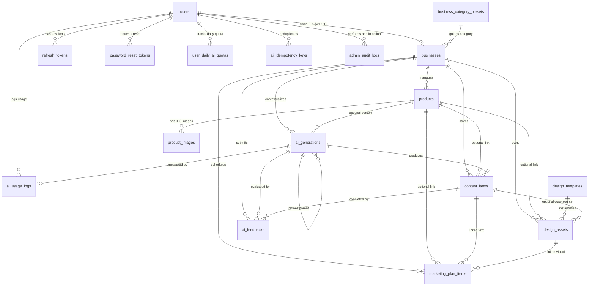
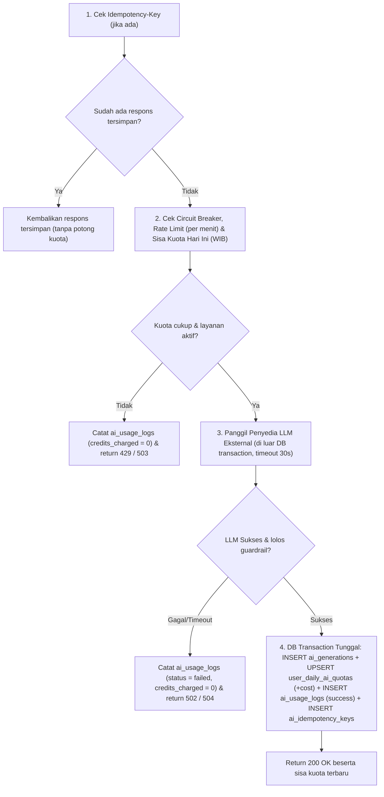

# Database Design — DagangAI

> **Status:** Draft v1.0 (Ready for Engineering Review)  
> **Document Type:** Database Architecture & Schema Specification  
> **Product:** DagangAI  
> **Release Target:** V1.0 — Competition MVP  
> **Target DBMS:** PostgreSQL 16+ (dengan dukungan opsional Redis untuk *in-memory rate limiting*)  
> **Version:** 1.0.0  
> **Last Updated:** 27 November 2026  
> **Source Documents:** [PRD.md](./PRD.md) (v1.0.0), [API-spec.md](./API-spec.md) (v1.0.0)  
> **Document Purpose:** Menetapkan rancangan skema basis data relasional, batasan integritas (*constraints*), strategi indeks, kontrak kolom `JSONB`, pola transaksi kuota AI, serta struktur penyimpanan berkas (*object storage*) untuk mendukung seluruh kebutuhan DagangAI V1.0.

---

## Daftar Isi

1. [Keputusan Arsitektur Basis Data](#1-keputusan-arsitektur-basis-data)
2. [Entity Relationship Diagram (ERD)](#2-entity-relationship-diagram-erd)
3. [Daftar Enumerasi Database](#3-daftar-enumerasi-database)
4. [Spesifikasi Skema Tabel](#4-spesifikasi-skema-tabel)
5. [Kontrak Struktur Kolom JSONB](#5-kontrak-struktur-kolom-jsonb)
6. [Strategi Indeks dan Optimasi Query](#6-strategi-indeks-dan-optimasi-query)
7. [Pola Transaksi, Kuota AI Harian (WIB), dan Idempotency](#7-pola-transaksi-kuota-ai-harian-wib-dan-idempotency)
8. [Kebijakan Soft Delete, Snapshot Historis, dan Retensi Data](#8-kebijakan-soft-delete-snapshot-historis-dan-retensi-data)
9. [Struktur Object Storage (Media & Ekspor)](#9-struktur-object-storage-media--ekspor)
10. [Data Awal (Seed Data Wajib V1.0)](#10-data-awal-seed-data-wajib-v10)
11. [SQL Migration DDL Lengkap (PostgreSQL)](#11-sql-migration-ddl-lengkap-postgresql)
12. [Matriks Keterlacakan (Aturan Bisnis & API → Skema DB)](#12-matriks-keterlacakan-aturan-bisnis--api--skema-db)

---

# 1. Keputusan Arsitektur Basis Data

| Aspek | Keputusan V1.0 | Rasional |
|---|---|---|
| **DBMS Utama** | **PostgreSQL 16+** | Mendukung integritas relasional ketat (`UNIQUE`, `CHECK`, *partial index*), `TIMESTAMPTZ`, serta `JSONB` berindeks untuk konfigurasi template/desain dan snapshot konteks AI. |
| **Tipe Primary Key** | `UUID` (`gen_random_uuid()` atau UUIDv7 dari aplikasi) | Mencegah enumerasi ID berurutan (*IDOR hardening*), aman untuk distribusi klien, dan selaras dengan format ID di `API-spec.md`. |
| **Penegakan 1 Akun = 1 Bisnis (`BR-01`)** | `UNIQUE (owner_user_id)` pada tabel `businesses` | Menjamin aturan V1.0 ditegakkan langsung di level mesin database, bukan hanya validasi kode aplikasi. |
| **Isolasi Data Multi-Tenant (`BR-02`)** | Kolom `business_id NOT NULL` di seluruh entitas bisnis | Memungkinkan query selalu memfilter `WHERE business_id = $1` dengan indeks komposit untuk performa tinggi dan mencegah kebocoran lintas akun. |
| **Reset Kuota AI 00:00 WIB (`§13 PRD`)** | Kunci komposit `(user_id, usage_date_wib)` pada `user_daily_ai_quotas` | Menghilangkan kebutuhan *cron job* reset tengah malam; pergantian tanggal `Asia/Jakarta` otomatis membuka baris kuota baru. |
| **Penghapusan Produk (`BR-10`)** | *Soft delete* (`deleted_at`) + `product_name_snapshot` | Materi di Content Library, Design Studio, dan Marketing Planner tetap utuh dan informatif meski produk dihapus dari katalog aktif. |
| **Konfigurasi Operasional Runtime (`FR-39`)** | Tabel singleton `system_ai_configs` (`CHECK (id = 1)`) | Platform Admin dapat mengubah batas kuota harian, *rate limit*, dan *circuit breaker* tanpa redeploy aplikasi. |
| **Penyimpanan Berkas (`BR-12`)** | Metadata di PostgreSQL + biner gambar di Object Storage (S3-compatible / R2 / GCS) | Menghindari pembengkakan database oleh berkas biner dan memudahkan distribusi via CDN/signed URL. |

---

# 2. Entity Relationship Diagram (ERD)



---

# 3. Daftar Enumerasi Database

Seluruh domain nilai dari `API-spec.md` §3.3 direpresentasikan sebagai PostgreSQL `ENUM` agar konsisten, hemat ruang, dan tervalidasi otomatis:

| Nama Tipe Enum | Nilai Valid |
|---|---|
| `user_role` | `'business_owner'`, `'platform_admin'` |
| `user_status` | `'active'`, `'suspended'` |
| `business_category` | `'fnb'`, `'fashion_craft'`, `'beauty_care'`, `'photo_video'`, `'design_creative'`, `'local_service'`, `'other'` |
| `brand_tone` | `'friendly_casual'`, `'professional'`, `'elegant'`, `'energetic_promo'`, `'educational'`, `'storytelling'` |
| `language_preference` | `'id'`, `'en'`, `'id_casual_mix'` |
| `product_type` | `'product'`, `'service'` |
| `availability_status` | `'available'`, `'preorder'`, `'unavailable'` |
| `content_type` | `'social_caption'`, `'product_description'`, `'slogan_headline'`, `'cta'`, `'content_idea'`, `'promo_message'` |
| `marketing_channel` | `'instagram'`, `'tiktok'`, `'whatsapp'`, `'marketplace_catalog'`, `'general'` |
| `promo_goal` | `'product_intro'`, `'promo_discount'`, `'education_benefit'`, `'trust_testimonial'`, `'seasonal_reminder'` |
| `content_status` | `'draft'`, `'planned'`, `'published'` |
| `content_source` | `'ai_generated'`, `'manual'` |
| `aspect_ratio` | `'1:1'`, `'9:16'`, `'16:9'` |
| `export_format` | `'png'`, `'jpg'` |
| `template_segment` | `'fnb'`, `'fashion_craft'`, `'local_service'`, `'general'` |
| `ai_feature_type` | `'content_generate'`, `'content_refine'`, `'design_copy_assist'`, `'planner_ideas'` |
| `ai_usage_status` | `'success'`, `'failed'`, `'rate_limited'`, `'quota_exceeded'`, `'policy_blocked'`, `'circuit_open'` |

---

# 4. Spesifikasi Skema Tabel

Database terdiri dari **18 tabel** yang dikelompokkan dalam 5 domain fungsional:

## 4.1 Domain Autentikasi & Akun (M1)

### 1. `users`
Menyimpan kredensial dan status akun pengguna (`business_owner` dan `platform_admin`).
- **Constraint Penting:** Unik pada `LOWER(email)` (case-insensitive), `role` default `'business_owner'`, `status` default `'active'`, `suspended_reason` wajib diisi saat `status = 'suspended'`.

### 2. `refresh_tokens`
Menyimpan hash *refresh token* (SHA-256) untuk mendukung rotasi token, pencabutan saat logout, dan deteksi *token reuse*.
- **Relasi:** `user_id -> users(id) ON DELETE CASCADE`, self-reference `replaced_by_token_id -> refresh_tokens(id)`.

### 3. `password_reset_tokens`
Menyimpan hash token pemulihan kata sandi sekali pakai berbatas waktu (mis. TTL 30 menit).
- **Relasi:** `user_id -> users(id) ON DELETE CASCADE`.

## 4.2 Domain Bisnis & Produk (M2 & M3)

### 4. `business_category_presets`
Tabel referensi statis/terkelola berisi contoh pengisian, saran kategori produk, dan gaya komunikasi rekomendasi per `business_category` (`FR-09`).

### 5. `businesses`
Menyimpan profil dan identitas merek bisnis sebagai sumber konteks AI utama (`FR-05`–`FR-08`).
- **Constraint Penting:**
  - `owner_user_id UUID NOT NULL UNIQUE` (`BR-01`: 1 akun = tepat 1 bisnis).
  - Validasi panjang `description` ≤ 500 karakter (`§13 PRD`).
  - Validasi format hex `#RRGGBB` untuk `primary_color` dan `secondary_color`.
  - `unique_selling_points` dan `avoided_words` disimpan sebagai `JSONB` array string.

### 6. `products`
Menyimpan katalog produk dan layanan dalam bisnis (`FR-10`–`FR-13`).
- **Constraint Penting:**
  - `business_id -> businesses(id) ON DELETE CASCADE`.
  - `price_min >= 0` dan `price_max >= price_min` (bila keduanya diisi).
  - `deleted_at TIMESTAMPTZ NULL` untuk *soft delete* (`BR-10`).

### 7. `product_images`
Menyimpan metadata foto produk hingga maksimal **3 foto per produk** (`FR-11`, `BR-12`).
- **Constraint Penting:**
  - `file_size_bytes > 0 AND file_size_bytes <= 5242880` (maks. 5 MB).
  - `mime_type IN ('image/jpeg', 'image/png', 'image/webp')`.
  - *Partial unique index* `(product_id) WHERE is_primary = TRUE` menjamin hanya ada paling banyak 1 foto utama per produk.
  - Batas maksimal 3 foto ditegakkan pada transaksi aplikasi dengan row-lock pada baris `products` (`SELECT id FROM products WHERE id = $1 FOR UPDATE`).

## 4.3 Domain AI Content Studio & Content Library (M4 & M5)

### 8. `ai_generations`
Menyimpan riwayat sesi generasi/refine AI, ringkasan konteks yang disuntikkan, peringatan Responsible AI, dan keluaran mentah (`FR-14`–`FR-18`).
- **Relasi:** `parent_generation_id -> ai_generations(id)` untuk melacak rantai *Quick Refine*.

### 9. `content_items`
Repositori terpusat materi teks tersimpan di Content Library (`FR-17`, `FR-21`–`FR-23`).
- **Constraint Penting:**
  - `product_id -> products(id) ON DELETE SET NULL` disertai `product_name_snapshot` (`BR-10`).
  - `generation_id -> ai_generations(id) ON DELETE SET NULL`.
  - `deleted_at TIMESTAMPTZ NULL` untuk mendukung pemulihan/audit singkat.

### 10. `ai_feedbacks`
Menyimpan rating pengguna dan laporan klaim faktual/halusinasi (`FR-19`, metrik `User Relevance Rating` & `Hallucination Report Rate`).
- **Constraint Penting:** Minimal salah satu `generation_id` atau `content_item_id` wajib tidak null; `rating` (bila diisi) antara `1` dan `5`.

## 4.4 Domain AI Design Studio & Marketing Planner (M6 & M7)

### 11. `design_templates`
Katalog master template desain promosi siap pakai (`1:1`, `9:16`, `16:9`) beserta definisi batas karakter slot dan pasangan font preset (`FR-24`).

### 12. `design_assets`
Proyek desain promosi milik bisnis yang dapat dibuka, disunting ulang di mobile/desktop, dan diekspor ke PNG/JPG (`FR-25`–`FR-28`).
- **Relasi:** `template_id -> design_templates(id)`, `product_id -> products(id) ON DELETE SET NULL` (+ `product_name_snapshot`), `source_content_id -> content_items(id) ON DELETE SET NULL`.

### 13. `marketing_plan_items`
Item jadwal dan daftar rencana konten di Marketing Planner (`FR-29`–`FR-32`).
- **Constraint Penting (`BR-09`):**
  - `CHECK (status <> 'planned' OR scheduled_date IS NOT NULL)` — status `planned` wajib memiliki tanggal target publikasi.
  - `CHECK (status <> 'published' OR published_at IS NOT NULL)` — status `published` wajib mencatat timestamp publikasi manual.
  - Menyimpan snapshot judul (`product_name_snapshot`, `content_title_snapshot`, `design_title_snapshot`) agar item planner tetap terbaca jika materi/produk terkait dihapus.

## 4.5 Domain Operasional, Kuota AI, dan Admin (M8 & M9)

### 14. `user_daily_ai_quotas`
Tabel ringkas per `(user_id, usage_date_wib)` untuk pengecekan dan pemotongan kredit AI harian secara atomik dan cepat.

### 15. `ai_usage_logs`
Log append-only seluruh permintaan AI (sukses, gagal provider, rate limit, kuota habis, blokir moderasi, circuit breaker) beserta estimasi token & latensi untuk dashboard admin (`FR-37`, `FR-38`).

### 16. `system_ai_configs`
Tabel singleton (`id = 1`) menyimpan konfigurasi runtime: batas kredit harian, batas permintaan per menit, bobot kredit per fitur AI, serta status & pesan *global circuit breaker* (`FR-39`).

### 17. `ai_idempotency_keys`
Menyimpan respons endpoint AI berdasarkan `(user_id, idempotency_key)` selama 5 menit untuk mencegah pemotongan kuota ganda akibat klik berulang atau *network retry* (`§14 API-spec`).

### 18. `admin_audit_logs`
Mencatat setiap perubahan konfigurasi AI maupun aksi *suspend/unsuspend* akun oleh Platform Admin untuk akuntabilitas operasional (`FR-39`).

---

# 5. Kontrak Struktur Kolom JSONB

Penggunaan `JSONB` dibatasi khusus pada struktur semi-terstruktur agar skema tetap bersih tanpa mengorbankan integritas relasional:

## 5.1 `design_templates.slots_schema`
```json
{
  "headline": { "max_chars": 45, "required": true },
  "subheadline": { "max_chars": 90, "required": false },
  "price_or_badge": { "max_chars": 25, "required": false },
  "cta": { "max_chars": 35, "required": false }
}
```

## 5.2 `design_assets.config`
```json
{
  "texts": {
    "headline": "Es Kopi Susu Gula Aren",
    "subheadline": "Arabika lokal, susu segar & gula aren murni.",
    "price_or_badge": "Mulai Rp18.000",
    "cta": "Pesan via DM Sekarang"
  },
  "colors": {
    "background": "#FFF8F0",
    "accent": "#5C3A21",
    "text": "#231914"
  },
  "font_preset": "warm_artisan",
  "image": {
    "url": "https://cdn.dagangai.app/biz_.../prd_..._1.webp",
    "storage_key": "businesses/.../products/.../img_1.webp",
    "crop": { "zoom": 1.0, "offset_x": 0, "offset_y": 0 }
  },
  "show_logo": true,
  "logo_position": "top_left",
  "show_badge": true
}
```

## 5.3 `system_ai_configs.credit_costs`
```json
{
  "content_generate": 1,
  "content_refine": 1,
  "design_copy_assist": 1,
  "planner_ideas": 2
}
```

## 5.4 `ai_generations.context_summary`
```json
{
  "business_name": "Kopi Senja Nusantara",
  "product_name": "Es Kopi Susu Gula Aren",
  "brand_tone": "friendly_casual",
  "language": "id",
  "used_business_profile": true,
  "used_product_context": true
}
```

---

# 6. Strategi Indeks dan Optimasi Query

| Kebutuhan Query (`API-spec.md`) | Indeks yang Disediakan | Alasan Optimasi |
|---|---|---|
| Login & cek duplikat email (`POST /auth/login`, `/register`) | `UNIQUE INDEX idx_users_email_lower ON users (LOWER(email))` | Pencarian email case-insensitive dalam O(log n). |
| Daftar produk aktif + filter (`GET /products`) | `INDEX idx_products_biz_active ON products (business_id, availability_status, created_at DESC) WHERE deleted_at IS NULL` | Partial index mengecualikan produk yang sudah dihapus dan mempercepat sorting terbaru. |
| Pencarian nama produk & materi (`?search=`) | Ekstensi `pg_trgm` + `GIN` trigram index pada `products(name)` dan `content_items(title, body)` | Mendukung pencarian `ILIKE '%kopi%'` cepat untuk Bahasa Indonesia tanpa *sequential scan*. |
| Filter Pustaka Materi (`GET /contents`) | `INDEX idx_contents_biz_filter ON content_items (business_id, status, content_type, updated_at DESC) WHERE deleted_at IS NULL` | Mempercepat tampilan utama Content Library dan filter status/jenis. |
| Kalender & Daftar Planner (`GET /planner/items?from=&to=`) | `INDEX idx_planner_biz_schedule ON marketing_plan_items (business_id, scheduled_date, status) WHERE deleted_at IS NULL` | Range scan efisien untuk tampilan kalender bulanan/mingguan. |
| Product Coverage & Activity Summary (`GET /analytics/summary`) | `INDEX idx_contents_biz_product ON content_items (business_id, product_id) WHERE deleted_at IS NULL` dan `idx_designs_biz_product` | Menghitung produk paling sering vs belum pernah dipromosikan dengan agregasi cepat. |
| Ringkasan Operasional Admin (`GET /admin/overview`, `/ai-logs`) | `INDEX idx_ai_logs_date_status ON ai_usage_logs (usage_date_wib, status, feature)` dan `idx_ai_logs_user_created` | Agregasi harian total request, tingkat error, dan estimasi token tanpa scan tabel penuh. |
| Cleanup token & idempotency kedaluwarsa | `INDEX idx_idempotency_expires ON ai_idempotency_keys (expires_at)` | Mempercepat penghapusan berkala kunci idempotency > 5 menit. |

---

# 7. Pola Transaksi, Kuota AI Harian (WIB), dan Idempotency

Untuk mematuhi **`BR-07` (kuota hanya dipotong jika AI berhasil)** sekaligus mencegah *race condition* ketika pengguna mengirim beberapa permintaan paralel, alur server mengikuti pola **2-Tahap Non-Blocking LLM Call**:



### Catatan Penting Implementasi:
1. **Jangan menahan transaksi DB selama panggilan LLM** (yang bisa memakan 3–10 detik) agar *connection pool* PostgreSQL tidak habis.
2. **Perhitungan tanggal WIB:** `usage_date_wib = (NOW() AT TIME ZONE 'Asia/Jakarta')::DATE`. Saat waktu melewati `00:00 WIB`, baris baru otomatis terbuat untuk tanggal tersebut.
3. **Rate limiting per menit (5 req/menit/akun):** Direkomendasikan menggunakan *sliding window* di Redis; jika stack kompetisi tidak memakai Redis, gunakan query terindeks pada `ai_usage_logs WHERE user_id = $1 AND created_at >= NOW() - INTERVAL '1 minute'`.

---

# 8. Kebijakan Soft Delete, Snapshot Historis, dan Retensi Data

| Entitas | Mekanisme Hapus | Dampak Relasi & Retensi |
|---|---|---|
| `products` | *Soft delete* (`deleted_at`) | Tidak tampil lagi di katalog aktif `GET /products`. `content_items`, `design_assets`, dan `marketing_plan_items` tetap menyimpan `product_name_snapshot` dan menandai `product.is_deleted = true` (`BR-10`). |
| `content_items` | *Soft delete* (`deleted_at`) | Hilang dari Content Library. Item di `marketing_plan_items` yang tertaut tetap utuh dengan `content_title_snapshot`. |
| `design_assets` | *Soft delete* (`deleted_at`) | Hilang dari daftar desain. Berkas ekspor sementara di object storage dapat dibersihkan setelah 7 hari. |
| `marketing_plan_items` | *Soft delete* (`deleted_at`) | Hilang dari planner; tidak menghapus materi atau desain di pustaka. |
| `ai_idempotency_keys` | *Hard delete* terjadwal | Dihapus otomatis setelah `expires_at < NOW()` (TTL 5 menit). |
| `refresh_tokens` & `password_reset_tokens` | *Hard delete* terjadwal | Token yang kedaluwarsa/dicabut > 30 hari dibersihkan berkala. |
| `ai_usage_logs` & `admin_audit_logs` | *Append-only* (tidak dihapus) | Dipertahankan selama seluruh periode kompetisi untuk audit biaya dan keandalan. |

---

# 9. Struktur Object Storage (Media & Ekspor)

Seluruh berkas biner disimpan di Object Storage dengan penamaan terisolasi per `business_id` dan nama berkas acak (UUID) untuk keamanan (`BR-12`, `NFR-05`):

```text
dagangai-media/
├── templates/                                      # Aset publik/read-only template
│   └── {template_id}/
│       └── thumbnail.webp
├── businesses/
│   └── {business_id}/
│       ├── logo/{uuid}.{ext}                       # Logo bisnis (maks. 5 MB)
│       ├── products/{product_id}/{uuid}.{ext}      # Foto produk (maks. 3 file x 5 MB)
│       ├── designs/{design_id}/preview.webp        # Pratinjau desain tersimpan
│       └── exports/{design_id}/{uuid}.{png|jpg}    # Hasil ekspor ≥ 1080px (signed URL 1 jam)
```

---

# 10. Data Awal (Seed Data Wajib V1.0)

Sebelum aplikasi dijalankan pertama kali, migrasi *seed* wajib mengisi tiga tabel berikut:
1. **`system_ai_configs` (`id = 1`)**:
   - `daily_credits_limit = 30`, `rate_limit_per_minute = 5`, `credit_costs = {"content_generate": 1, "content_refine": 1, "design_copy_assist": 1, "planner_ideas": 2}`, `circuit_breaker_open = FALSE`.
2. **`business_category_presets`**:
   - Minimal 7 baris mencakup seluruh enum `business_category`, dengan penandaan `is_priority_segment = TRUE` dan konten contoh kaya untuk `fnb`, `fashion_craft`, dan `local_service` (`D-07`, `FR-09`).
3. **`design_templates`**:
   - Minimal 9–12 template aktif mencakup kombinasi rasio (`1:1`, `9:16`, `16:9`) untuk segmen `fnb`, `fashion_craft`, `local_service`, dan `general` (`FR-24`).
4. **Akun `platform_admin` awal**:
   - Disediakan melalui variabel lingkungan (*env*) saat *bootstrap* awal (tidak *hardcode* kata sandi di repositori kode).

---

# 11. SQL Migration DDL Lengkap (PostgreSQL)

Skema berikut siap dijadikan migrasi awal (`0001_initial_schema.sql`) pada PostgreSQL 16+:

```sql
-- =============================================================================
-- DagangAI V1.0 — Initial Database Schema (PostgreSQL 16+)
-- Aligned with PRD.md v1.0.0 & API-spec.md v1.0.0
-- =============================================================================

CREATE EXTENSION IF NOT EXISTS pgcrypto;
CREATE EXTENSION IF NOT EXISTS pg_trgm;

-- -----------------------------------------------------------------------------
-- 1. ENUM TYPES
-- -----------------------------------------------------------------------------
CREATE TYPE user_role AS ENUM ('business_owner', 'platform_admin');
CREATE TYPE user_status AS ENUM ('active', 'suspended');

CREATE TYPE business_category AS ENUM (
    'fnb', 'fashion_craft', 'beauty_care', 'photo_video',
    'design_creative', 'local_service', 'other'
);

CREATE TYPE brand_tone AS ENUM (
    'friendly_casual', 'professional', 'elegant',
    'energetic_promo', 'educational', 'storytelling'
);

CREATE TYPE language_preference AS ENUM ('id', 'en', 'id_casual_mix');
CREATE TYPE product_type AS ENUM ('product', 'service');
CREATE TYPE availability_status AS ENUM ('available', 'preorder', 'unavailable');

CREATE TYPE content_type AS ENUM (
    'social_caption', 'product_description', 'slogan_headline',
    'cta', 'content_idea', 'promo_message'
);

CREATE TYPE marketing_channel AS ENUM (
    'instagram', 'tiktok', 'whatsapp', 'marketplace_catalog', 'general'
);

CREATE TYPE promo_goal AS ENUM (
    'product_intro', 'promo_discount', 'education_benefit',
    'trust_testimonial', 'seasonal_reminder'
);

CREATE TYPE content_status AS ENUM ('draft', 'planned', 'published');
CREATE TYPE content_source AS ENUM ('ai_generated', 'manual');
CREATE TYPE aspect_ratio AS ENUM ('1:1', '9:16', '16:9');
CREATE TYPE export_format AS ENUM ('png', 'jpg');
CREATE TYPE template_segment AS ENUM ('fnb', 'fashion_craft', 'local_service', 'general');

CREATE TYPE ai_feature_type AS ENUM (
    'content_generate', 'content_refine', 'design_copy_assist', 'planner_ideas'
);

CREATE TYPE ai_usage_status AS ENUM (
    'success', 'failed', 'rate_limited', 'quota_exceeded', 'policy_blocked', 'circuit_open'
);

-- -----------------------------------------------------------------------------
-- 2. AUTHENTICATION & ACCOUNTS (M1)
-- -----------------------------------------------------------------------------
CREATE TABLE users (
    id                UUID PRIMARY KEY DEFAULT gen_random_uuid(),
    full_name         VARCHAR(100) NOT NULL CHECK (char_length(trim(full_name)) >= 2),
    email             VARCHAR(255) NOT NULL,
    password_hash     TEXT NOT NULL,
    role              user_role NOT NULL DEFAULT 'business_owner',
    status            user_status NOT NULL DEFAULT 'active',
    suspended_reason  VARCHAR(300),
    suspended_at      TIMESTAMPTZ,
    created_at        TIMESTAMPTZ NOT NULL DEFAULT NOW(),
    updated_at        TIMESTAMPTZ NOT NULL DEFAULT NOW(),
    CONSTRAINT chk_users_suspended_reason
        CHECK (status <> 'suspended' OR (suspended_reason IS NOT NULL AND char_length(trim(suspended_reason)) >= 5))
);

CREATE UNIQUE INDEX idx_users_email_lower ON users (LOWER(email));
CREATE INDEX idx_users_role_status ON users (role, status);

CREATE TABLE refresh_tokens (
    id                   UUID PRIMARY KEY DEFAULT gen_random_uuid(),
    user_id              UUID NOT NULL REFERENCES users(id) ON DELETE CASCADE,
    token_hash           CHAR(64) NOT NULL UNIQUE,
    replaced_by_token_id UUID REFERENCES refresh_tokens(id) ON DELETE SET NULL,
    expires_at           TIMESTAMPTZ NOT NULL,
    revoked_at           TIMESTAMPTZ,
    user_agent           VARCHAR(300),
    ip_address           INET,
    created_at           TIMESTAMPTZ NOT NULL DEFAULT NOW()
);

CREATE INDEX idx_refresh_tokens_user ON refresh_tokens (user_id, expires_at DESC);

CREATE TABLE password_reset_tokens (
    id         UUID PRIMARY KEY DEFAULT gen_random_uuid(),
    user_id    UUID NOT NULL REFERENCES users(id) ON DELETE CASCADE,
    token_hash CHAR(64) NOT NULL UNIQUE,
    expires_at TIMESTAMPTZ NOT NULL,
    used_at    TIMESTAMPTZ,
    created_at TIMESTAMPTZ NOT NULL DEFAULT NOW()
);

CREATE INDEX idx_password_reset_user ON password_reset_tokens (user_id, expires_at DESC);

-- -----------------------------------------------------------------------------
-- 3. BUSINESS & PRODUCT MANAGEMENT (M2 & M3)
-- -----------------------------------------------------------------------------
CREATE TABLE business_category_presets (
    category                     business_category PRIMARY KEY,
    label                        VARCHAR(100) NOT NULL,
    is_priority_segment          BOOLEAN NOT NULL DEFAULT FALSE,
    example_description          VARCHAR(500) NOT NULL,
    example_usps                 JSONB NOT NULL DEFAULT '[]'::jsonb,
    example_target_audience      VARCHAR(300) NOT NULL,
    recommended_tones            JSONB NOT NULL DEFAULT '[]'::jsonb,
    suggested_product_categories JSONB NOT NULL DEFAULT '[]'::jsonb,
    updated_at                   TIMESTAMPTZ NOT NULL DEFAULT NOW()
);

CREATE TABLE businesses (
    id                          UUID PRIMARY KEY DEFAULT gen_random_uuid(),
    owner_user_id               UUID NOT NULL UNIQUE REFERENCES users(id) ON DELETE CASCADE, -- BR-01: 1 akun = 1 bisnis
    name                        VARCHAR(100) NOT NULL CHECK (char_length(trim(name)) >= 2),
    category                    business_category NOT NULL REFERENCES business_category_presets(category),
    description                 VARCHAR(500) NOT NULL CHECK (char_length(trim(description)) >= 10),
    location                    VARCHAR(120),
    unique_selling_points       JSONB NOT NULL DEFAULT '[]'::jsonb,
    target_audience_age_range   VARCHAR(60),
    target_audience_description VARCHAR(300),
    language_preference         language_preference NOT NULL DEFAULT 'id',
    brand_tone                  brand_tone NOT NULL DEFAULT 'friendly_casual',
    avoided_words               JSONB NOT NULL DEFAULT '[]'::jsonb,
    primary_color               CHAR(7) CHECK (primary_color IS NULL OR primary_color ~ '^#[0-9A-Fa-f]{6}$'),
    secondary_color             CHAR(7) CHECK (secondary_color IS NULL OR secondary_color ~ '^#[0-9A-Fa-f]{6}$'),
    logo_storage_key            VARCHAR(500),
    logo_url                    TEXT,
    created_at                  TIMESTAMPTZ NOT NULL DEFAULT NOW(),
    updated_at                  TIMESTAMPTZ NOT NULL DEFAULT NOW()
);

CREATE TABLE products (
    id                  UUID PRIMARY KEY DEFAULT gen_random_uuid(),
    business_id         UUID NOT NULL REFERENCES businesses(id) ON DELETE CASCADE,
    name                VARCHAR(120) NOT NULL CHECK (char_length(trim(name)) >= 2),
    type                product_type NOT NULL DEFAULT 'product',
    category            VARCHAR(80),
    description         VARCHAR(500) NOT NULL CHECK (char_length(trim(description)) >= 10),
    currency            CHAR(3) NOT NULL DEFAULT 'IDR',
    price_min           BIGINT CHECK (price_min IS NULL OR price_min >= 0),
    price_max           BIGINT CHECK (price_max IS NULL OR price_max >= 0),
    key_benefits        JSONB NOT NULL DEFAULT '[]'::jsonb,
    availability_status availability_status NOT NULL DEFAULT 'available',
    deleted_at          TIMESTAMPTZ,
    created_at          TIMESTAMPTZ NOT NULL DEFAULT NOW(),
    updated_at          TIMESTAMPTZ NOT NULL DEFAULT NOW(),
    CONSTRAINT chk_products_price_range
        CHECK (price_max IS NULL OR price_min IS NULL OR price_max >= price_min)
);

CREATE INDEX idx_products_biz_active
    ON products (business_id, availability_status, created_at DESC)
    WHERE deleted_at IS NULL;
CREATE INDEX idx_products_name_trgm
    ON products USING GIN (name gin_trgm_ops)
    WHERE deleted_at IS NULL;

CREATE TABLE product_images (
    id              UUID PRIMARY KEY DEFAULT gen_random_uuid(),
    product_id      UUID NOT NULL REFERENCES products(id) ON DELETE CASCADE,
    business_id     UUID NOT NULL REFERENCES businesses(id) ON DELETE CASCADE,
    storage_key     VARCHAR(500) NOT NULL,
    url             TEXT NOT NULL,
    mime_type       VARCHAR(30) NOT NULL CHECK (mime_type IN ('image/jpeg', 'image/png', 'image/webp')),
    file_size_bytes INTEGER NOT NULL CHECK (file_size_bytes > 0 AND file_size_bytes <= 5242880), -- BR-12: <= 5 MB
    is_primary      BOOLEAN NOT NULL DEFAULT FALSE,
    sort_order      SMALLINT NOT NULL DEFAULT 0,
    created_at      TIMESTAMPTZ NOT NULL DEFAULT NOW()
);

CREATE INDEX idx_product_images_product ON product_images (product_id, sort_order ASC);
CREATE UNIQUE INDEX idx_product_images_single_primary
    ON product_images (product_id)
    WHERE is_primary = TRUE;

-- -----------------------------------------------------------------------------
-- 4. AI CONTENT STUDIO & CONTENT LIBRARY (M4 & M5)
-- -----------------------------------------------------------------------------
CREATE TABLE ai_generations (
    id                   UUID PRIMARY KEY DEFAULT gen_random_uuid(),
    business_id          UUID NOT NULL REFERENCES businesses(id) ON DELETE CASCADE,
    user_id              UUID NOT NULL REFERENCES users(id) ON DELETE CASCADE,
    parent_generation_id UUID REFERENCES ai_generations(id) ON DELETE SET NULL,
    feature              ai_feature_type NOT NULL,
    product_id           UUID REFERENCES products(id) ON DELETE SET NULL,
    content_type         content_type,
    channel              marketing_channel,
    promo_goal           promo_goal,
    input_snapshot       JSONB NOT NULL DEFAULT '{}'::jsonb,
    context_summary      JSONB NOT NULL DEFAULT '{}'::jsonb,
    output_payload       JSONB NOT NULL DEFAULT '{}'::jsonb,
    warnings             JSONB NOT NULL DEFAULT '[]'::jsonb,
    created_at           TIMESTAMPTZ NOT NULL DEFAULT NOW()
);

CREATE INDEX idx_ai_generations_biz_created ON ai_generations (business_id, created_at DESC);

CREATE TABLE content_items (
    id                    UUID PRIMARY KEY DEFAULT gen_random_uuid(),
    business_id           UUID NOT NULL REFERENCES businesses(id) ON DELETE CASCADE,
    product_id            UUID REFERENCES products(id) ON DELETE SET NULL,
    product_name_snapshot VARCHAR(120), -- BR-10: nama historis jika produk dihapus
    generation_id         UUID REFERENCES ai_generations(id) ON DELETE SET NULL,
    title                 VARCHAR(150) NOT NULL CHECK (char_length(trim(title)) >= 2),
    content_type          content_type NOT NULL,
    channel               marketing_channel NOT NULL DEFAULT 'general',
    status                content_status NOT NULL DEFAULT 'draft',
    headline              VARCHAR(300),
    body                  TEXT NOT NULL CHECK (char_length(body) BETWEEN 1 AND 5000),
    cta                   VARCHAR(300),
    hashtags              JSONB NOT NULL DEFAULT '[]'::jsonb,
    brand_tone            brand_tone,
    source                content_source NOT NULL DEFAULT 'manual',
    deleted_at            TIMESTAMPTZ,
    created_at            TIMESTAMPTZ NOT NULL DEFAULT NOW(),
    updated_at            TIMESTAMPTZ NOT NULL DEFAULT NOW()
);

CREATE INDEX idx_contents_biz_filter
    ON content_items (business_id, status, content_type, updated_at DESC)
    WHERE deleted_at IS NULL;
CREATE INDEX idx_contents_biz_product
    ON content_items (business_id, product_id)
    WHERE deleted_at IS NULL;
CREATE INDEX idx_contents_search_trgm
    ON content_items USING GIN ((title || ' ' || body) gin_trgm_ops)
    WHERE deleted_at IS NULL;

CREATE TABLE ai_feedbacks (
    id               UUID PRIMARY KEY DEFAULT gen_random_uuid(),
    business_id      UUID NOT NULL REFERENCES businesses(id) ON DELETE CASCADE,
    user_id          UUID NOT NULL REFERENCES users(id) ON DELETE CASCADE,
    generation_id    UUID REFERENCES ai_generations(id) ON DELETE SET NULL,
    content_item_id  UUID REFERENCES content_items(id) ON DELETE SET NULL,
    rating           SMALLINT CHECK (rating IS NULL OR rating BETWEEN 1 AND 5),
    is_helpful       BOOLEAN,
    is_factual_issue BOOLEAN NOT NULL DEFAULT FALSE,
    issue_categories JSONB NOT NULL DEFAULT '[]'::jsonb,
    notes            VARCHAR(500),
    created_at       TIMESTAMPTZ NOT NULL DEFAULT NOW(),
    CONSTRAINT chk_feedback_target CHECK (generation_id IS NOT NULL OR content_item_id IS NOT NULL)
);

CREATE INDEX idx_ai_feedbacks_factual ON ai_feedbacks (is_factual_issue, created_at DESC);

-- -----------------------------------------------------------------------------
-- 5. AI DESIGN STUDIO (M6)
-- -----------------------------------------------------------------------------
CREATE TABLE design_templates (
    id                VARCHAR(64) PRIMARY KEY,
    name              VARCHAR(100) NOT NULL,
    segment           template_segment NOT NULL DEFAULT 'general',
    aspect_ratio      aspect_ratio NOT NULL,
    width_px          INTEGER NOT NULL CHECK (width_px >= 1080),
    height_px         INTEGER NOT NULL CHECK (height_px >= 1080 OR width_px >= 1080),
    thumbnail_url     TEXT NOT NULL,
    supports_logo     BOOLEAN NOT NULL DEFAULT TRUE,
    supports_badge    BOOLEAN NOT NULL DEFAULT TRUE,
    slots_schema      JSONB NOT NULL,
    font_presets      JSONB NOT NULL DEFAULT '[]'::jsonb,
    default_colors    JSONB NOT NULL,
    layout_definition JSONB NOT NULL DEFAULT '{}'::jsonb,
    is_active         BOOLEAN NOT NULL DEFAULT TRUE,
    sort_order        SMALLINT NOT NULL DEFAULT 0,
    created_at        TIMESTAMPTZ NOT NULL DEFAULT NOW(),
    updated_at        TIMESTAMPTZ NOT NULL DEFAULT NOW()
);

CREATE INDEX idx_design_templates_browse
    ON design_templates (segment, aspect_ratio, sort_order ASC)
    WHERE is_active = TRUE;

CREATE TABLE design_assets (
    id                        UUID PRIMARY KEY DEFAULT gen_random_uuid(),
    business_id               UUID NOT NULL REFERENCES businesses(id) ON DELETE CASCADE,
    template_id               VARCHAR(64) NOT NULL REFERENCES design_templates(id),
    product_id                UUID REFERENCES products(id) ON DELETE SET NULL,
    product_name_snapshot     VARCHAR(120),
    source_content_id         UUID REFERENCES content_items(id) ON DELETE SET NULL,
    title                     VARCHAR(150) NOT NULL CHECK (char_length(trim(title)) >= 2),
    aspect_ratio              aspect_ratio NOT NULL,
    config                    JSONB NOT NULL,
    preview_storage_key       VARCHAR(500),
    preview_url               TEXT,
    last_exported_format      export_format,
    last_exported_storage_key VARCHAR(500),
    last_exported_at          TIMESTAMPTZ,
    deleted_at                TIMESTAMPTZ,
    created_at                TIMESTAMPTZ NOT NULL DEFAULT NOW(),
    updated_at                TIMESTAMPTZ NOT NULL DEFAULT NOW()
);

CREATE INDEX idx_designs_biz_updated
    ON design_assets (business_id, updated_at DESC)
    WHERE deleted_at IS NULL;
CREATE INDEX idx_designs_biz_product
    ON design_assets (business_id, product_id)
    WHERE deleted_at IS NULL;

-- -----------------------------------------------------------------------------
-- 6. MARKETING PLANNER (M7)
-- -----------------------------------------------------------------------------
CREATE TABLE marketing_plan_items (
    id                     UUID PRIMARY KEY DEFAULT gen_random_uuid(),
    business_id            UUID NOT NULL REFERENCES businesses(id) ON DELETE CASCADE,
    product_id             UUID REFERENCES products(id) ON DELETE SET NULL,
    product_name_snapshot  VARCHAR(120),
    content_item_id        UUID REFERENCES content_items(id) ON DELETE SET NULL,
    content_title_snapshot VARCHAR(150),
    design_asset_id        UUID REFERENCES design_assets(id) ON DELETE SET NULL,
    design_title_snapshot  VARCHAR(150),
    title                  VARCHAR(150) NOT NULL CHECK (char_length(trim(title)) >= 2),
    campaign_name          VARCHAR(120),
    channel                marketing_channel NOT NULL DEFAULT 'general',
    scheduled_date         DATE,
    status                 content_status NOT NULL DEFAULT 'draft',
    published_at           TIMESTAMPTZ,
    notes                  TEXT,
    deleted_at             TIMESTAMPTZ,
    created_at             TIMESTAMPTZ NOT NULL DEFAULT NOW(),
    updated_at             TIMESTAMPTZ NOT NULL DEFAULT NOW(),
    -- BR-09: planned wajib tanggal; published wajib timestamp
    CONSTRAINT chk_planner_planned_date
        CHECK (status <> 'planned' OR scheduled_date IS NOT NULL),
    CONSTRAINT chk_planner_published_timestamp
        CHECK (status <> 'published' OR published_at IS NOT NULL)
);

CREATE INDEX idx_planner_biz_schedule
    ON marketing_plan_items (business_id, scheduled_date ASC, status)
    WHERE deleted_at IS NULL;
CREATE INDEX idx_planner_biz_status
    ON marketing_plan_items (business_id, status, updated_at DESC)
    WHERE deleted_at IS NULL;

-- -----------------------------------------------------------------------------
-- 7. OPERATIONAL, AI QUOTA & PLATFORM ADMIN (M8 & M9)
-- -----------------------------------------------------------------------------
CREATE TABLE system_ai_configs (
    id                      SMALLINT PRIMARY KEY DEFAULT 1 CHECK (id = 1), -- Singleton row
    daily_credits_limit     INTEGER NOT NULL DEFAULT 30 CHECK (daily_credits_limit >= 0),
    rate_limit_per_minute   INTEGER NOT NULL DEFAULT 5 CHECK (rate_limit_per_minute >= 1),
    credit_costs            JSONB NOT NULL DEFAULT '{"content_generate":1,"content_refine":1,"design_copy_assist":1,"planner_ideas":2}'::jsonb,
    circuit_breaker_open    BOOLEAN NOT NULL DEFAULT FALSE,
    circuit_breaker_message VARCHAR(300),
    updated_by              UUID REFERENCES users(id) ON DELETE SET NULL,
    updated_at              TIMESTAMPTZ NOT NULL DEFAULT NOW()
);

CREATE TABLE user_daily_ai_quotas (
    user_id        UUID NOT NULL REFERENCES users(id) ON DELETE CASCADE,
    usage_date_wib DATE NOT NULL, -- (NOW() AT TIME ZONE 'Asia/Jakarta')::DATE
    credits_used   INTEGER NOT NULL DEFAULT 0 CHECK (credits_used >= 0),
    updated_at     TIMESTAMPTZ NOT NULL DEFAULT NOW(),
    PRIMARY KEY (user_id, usage_date_wib)
);

CREATE TABLE ai_usage_logs (
    id                      UUID PRIMARY KEY DEFAULT gen_random_uuid(),
    user_id                 UUID NOT NULL REFERENCES users(id) ON DELETE CASCADE,
    business_id             UUID REFERENCES businesses(id) ON DELETE SET NULL,
    generation_id           UUID REFERENCES ai_generations(id) ON DELETE SET NULL,
    feature                 ai_feature_type NOT NULL,
    status                  ai_usage_status NOT NULL,
    credits_charged         SMALLINT NOT NULL DEFAULT 0 CHECK (credits_charged >= 0),
    provider_name           VARCHAR(60),
    model_name              VARCHAR(80),
    estimated_input_tokens  INTEGER CHECK (estimated_input_tokens IS NULL OR estimated_input_tokens >= 0),
    estimated_output_tokens INTEGER CHECK (estimated_output_tokens IS NULL OR estimated_output_tokens >= 0),
    latency_ms              INTEGER CHECK (latency_ms IS NULL OR latency_ms >= 0),
    error_code              VARCHAR(64),
    usage_date_wib          DATE NOT NULL,
    created_at              TIMESTAMPTZ NOT NULL DEFAULT NOW(),
    -- BR-07: Kuota hanya boleh dipotong bila permintaan sukses
    CONSTRAINT chk_ai_logs_credits_only_on_success
        CHECK (status = 'success' OR credits_charged = 0)
);

CREATE INDEX idx_ai_logs_date_status ON ai_usage_logs (usage_date_wib DESC, status, feature);
CREATE INDEX idx_ai_logs_user_created ON ai_usage_logs (user_id, created_at DESC);

CREATE TABLE ai_idempotency_keys (
    user_id         UUID NOT NULL REFERENCES users(id) ON DELETE CASCADE,
    idempotency_key VARCHAR(128) NOT NULL,
    endpoint        VARCHAR(120) NOT NULL,
    request_hash    CHAR(64) NOT NULL,
    response_status SMALLINT NOT NULL,
    response_body   JSONB NOT NULL,
    created_at      TIMESTAMPTZ NOT NULL DEFAULT NOW(),
    expires_at      TIMESTAMPTZ NOT NULL,
    PRIMARY KEY (user_id, idempotency_key)
);

CREATE INDEX idx_idempotency_expires ON ai_idempotency_keys (expires_at);

CREATE TABLE admin_audit_logs (
    id            UUID PRIMARY KEY DEFAULT gen_random_uuid(),
    admin_user_id UUID NOT NULL REFERENCES users(id) ON DELETE RESTRICT,
    action        VARCHAR(80) NOT NULL, -- mis. 'UPDATE_AI_CONFIG', 'SUSPEND_USER', 'ACTIVATE_USER'
    target_type   VARCHAR(50) NOT NULL, -- mis. 'system_ai_configs', 'user'
    target_id     VARCHAR(80) NOT NULL,
    reason        VARCHAR(300),
    changes       JSONB NOT NULL DEFAULT '{}'::jsonb,
    created_at    TIMESTAMPTZ NOT NULL DEFAULT NOW()
);

CREATE INDEX idx_admin_audit_created ON admin_audit_logs (created_at DESC);
```

---

# 12. Matriks Keterlacakan (Aturan Bisnis & API → Skema DB)

| Referensi PRD / API | Penegakan di Database |
|---|---|
| **`BR-01` (1 Akun = 1 Bisnis)** | `businesses.owner_user_id UNIQUE` |
| **`BR-02` (Isolasi Data Lintas Akun)** | `business_id NOT NULL` + indeks berawalan `business_id` di `products`, `content_items`, `design_assets`, `marketing_plan_items`, `ai_generations` |
| **`BR-07` (Error AI Tidak Potong Kuota)** | `CHECK (status = 'success' OR credits_charged = 0)` pada `ai_usage_logs` + transaksi 2-tahap (`§7`) |
| **`BR-09` (Siklus Status Konten)** | `chk_planner_planned_date` & `chk_planner_published_timestamp` pada `marketing_plan_items` |
| **`BR-10` (Hapus Produk Jaga Materi)** | `products.deleted_at` + `ON DELETE SET NULL` + `product_name_snapshot` di `content_items`, `design_assets`, `marketing_plan_items` |
| **`BR-12` (Validasi Foto ≤ 5 MB)** | `product_images` (`mime_type` & `file_size_bytes <= 5242880`) + *partial unique index* `is_primary` |
| **`FR-19` (Responsible AI Feedback)** | `ai_feedbacks` (`rating`, `is_factual_issue`, `issue_categories`) |
| **`FR-33`–`FR-36` (Activity Summary)** | Agregasi langsung dari `ai_generations`, `content_items`, `design_assets`, `marketing_plan_items`, `products`, dan `user_daily_ai_quotas` |
| **`FR-37`–`FR-39` (Operasional Admin)** | `system_ai_configs` (singleton), `ai_usage_logs`, `users.status`, dan `admin_audit_logs` |

---

## Revision History

| Version | Date | Description |
|---|---|---|
| 1.0.0 | 2026-11-27 | Penyusunan rancangan basis data PostgreSQL V1.0 DagangAI lengkap dengan ERD, 18 tabel, kontrak JSONB, strategi indeks, pola transaksi kuota WIB & idempotency, struktur object storage, serta DDL migrasi awal. |
