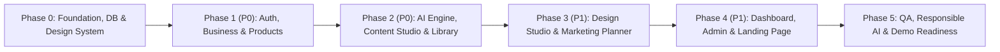

# Implementation Task Plan — DagangAI (V1.0 Competition MVP)

> **Status:** Ready for Execution  
> **Document Type:** Engineering Work Breakdown Structure (WBS) & Task Checklist  
> **Product:** DagangAI  
> **Release Target:** V1.0 — Competition MVP  
> **Version:** 1.0.0  
> **Last Updated:** 27 November 2026  
> **Source Documents:** [PRD.md](./PRD.md), [API-spec.md](./API-spec.md), [database-design.md](./database-design.md), [design.md](./design.md)  
> **Document Purpose:** Memecah seluruh spesifikasi DagangAI V1.0 menjadi daftar tugas implementasi yang konkret, berurutan berdasarkan dependensi, terklasifikasi prioritas (`P0` / `P1`), dan dapat langsung digunakan untuk pelacakan progres tim hingga siap demo kompetisi.

---

## 1. Peta Fase & Strategi Pengiriman

Pengembangan dibagi menjadi **6 fase berurutan**. Penyelesaian **Phase 0 + Phase 1 + Phase 2** menghasilkan **Core MVP (`P0`)** yang sudah dapat digunakan dan didemonstrasikan secara utuh, sementara **Phase 3 + Phase 4** melengkapi nilai *Integrated Workspace* (`P1`), dan **Phase 5** memastikan kualitas, keandalan Responsible AI, serta kesiapan presentasi lomba.

### Konvensi Label Tugas
- **Prioritas:** `[P0]` Wajib MVP · `[P1]` Penting untuk *Integrated Workspace* · `[P2]` Stretch
- **Area:** `Infra` · `DB` · `BE` · `AI` · `FE` · `QA`

---

## 2. Phase 0 — Foundation, Database & Design System Setup

**Tujuan:** Menyiapkan fondasi repositori, skema PostgreSQL lengkap, penyimpanan media, kerangka API standar, dan komponen dasar Design System agar seluruh tim dapat mengembangkan modul secara paralel.

### 2.1 Infrastruktur & Database
- [x] **T-001** `[P0][Infra]` Inisialisasi struktur repositori (backend, frontend, shared types/env template, linting, formatting, dan script development lokal).
- [x] **T-002** `[P0][DB]` Buat migrasi awal `0001_initial_schema.sql` pada PostgreSQL 16+ berisi 18 tabel, 17 enum, `CHECK` constraint (`BR-01`, `BR-07`, `BR-09`, `BR-12`), ekstensi `pgcrypto` & `pg_trgm`, serta seluruh indeks (`database-design.md §11`).
- [x] **T-003** `[P0][DB]` Buat *seed script* idempoten untuk `system_ai_configs` (`id = 1`), 7 baris `business_category_presets` (prioritas: F&B, Fashion/Kerajinan, Jasa Lokal), 12 baris `design_templates`, serta *bootstrap* akun `platform_admin` dari environment variable (`database-design.md §10`).
- [x] **T-004** `[P0][Infra]` Siapkan adapter *Object Storage* (S3-compatible/R2/local dev) dengan isolasi path per `business_id`, validasi MIME/magic-bytes (`JPG`/`PNG`/`WebP` ≤ 5 MB — `BR-12`), dan generator *signed URL* (`database-design.md §9`).

### 2.2 Fondasi Backend & Frontend
- [x] **T-005** `[P0][BE]` Bangun kerangka API `/api/v1`: *response envelope* (`success`, `data`, `error`, `meta.request_id`), katalog kode error terstandar (`API-spec.md §13`), validator payload, middleware paginasi, CORS, dan *rate limiter* dasar.
- [x] **T-006** `[P0][FE]` Implementasikan *design tokens* dari `design.md §2` (`#FAF8F5`, `#0F5C4D`, `#D96B27`, tipografi `Plus Jakarta Sans` + `Inter`, `tabular-nums`, skala spasi & radius).
- [x] **T-007** `[P0][FE]` Bangun komponen UI inti: `Button`, `Input/Textarea/Select` (min `16px` mobile), `StatusBadge` (`Draf`/`Terjadwal`/`Dipublikasikan`), `QuotaPill`, `EmptyStateCard`, `Toast`, dan `Modal` (desktop) / `BottomSheet` (mobile).
- [x] **T-008** `[P0][FE]` Bangun *Responsive App Shell* (`design.md §3`): Fixed Left Sidebar + Top Utility Bar (`≥ 1024px`), Collapsible Drawer (`768–1023px`), dan Top Bar + Bottom Nav 5 Tab + Sheet "Lainnya" (`360–767px`, target sentuh ≥ `44×44px`).

**Gate Phase 0:** Migrasi + seed berjalan bersih di database kosong; halaman kerangka workspace tampil tanpa *horizontal overflow* di `360px` dan `1280px`.

---

## 3. Phase 1 — M1–M3: Auth, Onboarding, Business & Product Management (P0)

**Tujuan:** Pengguna dapat mendaftar, masuk, melengkapi profil bisnis 1:1, dan mengelola katalog produk beserta fotonya.

### 3.1 M1 — Autentikasi & Akun (`FR-01`–`FR-04`)
- [x] **T-009** `[P0][BE]` Implementasikan `POST /auth/register`, `POST /auth/login`, `POST /auth/refresh` (rotasi `refresh_tokens`), dan `POST /auth/logout` beserta hashing kata sandi aman & proteksi akun `suspended`.
- [x] **T-010** `[P0][BE]` Implementasikan `POST /auth/forgot-password` (respons generik anti-enumerasi) dan `POST /auth/reset-password` dengan `password_reset_tokens` sekali pakai.
- [x] **T-011** `[P0][BE]` Implementasikan `GET /me`, `PATCH /me`, `PATCH /me/password`, serta middleware otorisasi RBAC (`business_owner`, `platform_admin`) dan resolusi `business_id` otomatis dari JWT (`BR-02`).
- [x] **T-012** `[P0][FE]` Bangun halaman Login, Daftar, Lupa/Reset Kata Sandi, Pengaturan Akun, serta *HTTP client interceptor* untuk refresh token otomatis & *redirect* onboarding saat `has_business === false`.

### 3.2 M2 — Business Management (`FR-05`–`FR-09`)
- [x] **T-013** `[P0][BE]` Implementasikan `POST /business` (tolak bisnis kedua dengan `409 BUSINESS_ALREADY_EXISTS` — `BR-01`), `GET /business`, `PATCH /business`, dan kalkulator `completeness` (`score`, `level`, `missing_fields`).
- [x] **T-014** `[P0][BE]` Implementasikan `POST /business/logo`, `DELETE /business/logo`, dan `GET /business/presets`.
- [x] **T-015** `[P0][FE]` Bangun *Onboarding Wizard* 2 Langkah (Identitas + tombol "Lihat Contoh Pengisian" per kategori → Karakter Merek & opsi "Lengkapi Nanti") dan guard agar akun yang sudah punya bisnis diarahkan ke edit profil (`FR-04`).
- [x] **T-016** `[P0][FE]` Bangun halaman Profil Bisnis lengkap dengan *progress bar* kelengkapan konteks, pemilih *brand tone*, tag input *kata yang dihindari*, *color picker*, dan unggah/hapus logo.

### 3.3 M3 — Product Management (`FR-10`–`FR-13`)
- [x] **T-017** `[P0][BE]` Implementasikan `GET /products` (pencarian trigram, filter tipe/status/kategori, paginasi), `POST /products`, `GET /products/{id}`, `PATCH /products/{id}`, dan `DELETE /products/{id}` (*soft delete* — `BR-10`).
- [x] **T-018** `[P0][BE]` Implementasikan manajemen foto produk: `POST /products/{id}/images` (validasi maks. 3 foto dengan *row lock* + auto-primary foto pertama), `PATCH .../primary`, dan `DELETE .../images/{image_id}`.
- [x] **T-019** `[P0][FE]` Bangun halaman Daftar Produk responsif (search, filter, kartu produk + tombol pintas **"Buat Konten"** `FR-13`) serta form Tambah/Ubah Produk dengan unggah maks. 3 foto dan validasi ≤ 5 MB di klien.

**Gate Phase 1:** Alur registrasi → onboarding 1 bisnis → tambah produk + 3 foto → hapus produk (*soft delete*) lulus seluruh pengujian `US-01` dan `US-02`.

---

## 4. Phase 2 — M4–M5: AI Engine, AI Content Studio & Content Library (P0)

**Tujuan:** Menyelesaikan nilai inti DagangAI — generasi & *Quick Refine* konten pemasaran kontekstual yang aman (*Responsible AI*), terkendali kuota, dan tersimpan rapi di Pustaka Materi.

### 4.1 AI Orchestration, Responsible AI & Kuota (`§10`, `§13`, `BR-03`–`BR-07`)
- [x] **T-020** `[P0][AI]` Bangun lapisan abstraksi penyedia LLM (*provider-agnostic adapter*) dengan batas *timeout* 30 detik, parser keluaran JSON terstruktur, dan pencatatan estimasi token & latensi (`NFR-04`, `NFR-09`).
- [x] **T-021** `[P0][AI]` Bangun *Context Builder* & *System Prompt Guardrails*: menyuntikkan Profil Bisnis + Produk terpilih + `avoided_words`, instruksi ketat anti-fabrikasi fakta (khususnya harga, diskon, Halal/BPOM, manfaat medis), detektor placeholder (`[...]`), dan moderasi dasar input/output (`§10.3`).
- [x] **T-022** `[P0][BE]` Implementasikan sistem kuota harian WIB (`user_daily_ai_quotas`), *rate limiting* per menit, *circuit breaker check*, `ai_idempotency_keys` (TTL 5 menit), serta pola transaksi 2-tahap agar error provider **tidak memotong kuota (`BR-07`)** + header `X-AI-Quota-*` & `X-RateLimit-*`.

### 4.2 M4 — AI Content Studio (`FR-14`–`FR-20`)
- [x] **T-023** `[P0][BE]` Implementasikan `GET /ai/quota`, `POST /ai/content/generate` (2–3 variasi + `context_summary` + `warnings` + `review_notice`), `POST /ai/content/refine` (5 preset + instruksi kustom ≤ 200 char), dan `POST /ai/feedback` (`is_factual_issue`).
- [x] **T-024** `[P0][FE]` Bangun halaman AI Content Studio (Desktop 2-pane / Mobile bertahap): Strip Konteks Aktif, banner peringatan konteks minim, form parameter terstruktur (6 jenis materi, pilih produk/bisnis umum, kanal, tujuan, gaya, info tambahan ≤ 300 char), dan *pre-fill* otomatis dari pintasan produk (`FR-13`).
- [x] **T-025** `[P0][FE]` Bangun panel hasil AI Content Studio: tab variasi, *inline editor* + penghitung karakter/kata + sorotan visual placeholder, tombol Salin/Simpan, panel **Quick Refine** + opsi *undo* ke versi sebelumnya (`US-04`), *Human Review Notice* (`BR-05`), dan widget rating/lapor fakta (`FR-19`).
- [x] **T-026** `[P0][FE]` Implementasikan seluruh *edge states* AI di UI: *loading skeleton* bertahap, state error provider (*"Kuota tidak berkurang"* + "Coba Lagi"), dan state kuota habis (`0`) dengan waktu reset `00.00 WIB` (`US-05`).

### 4.3 M5 — Content Library (`FR-21`–`FR-23`)
- [x] **T-027** `[P0][BE]` Implementasikan `GET /contents` (search trigram, filter jenis/produk/kanal/status), `POST /contents` (simpan snapshot nama produk), `GET /contents/{id}`, `PATCH /contents/{id}`, `POST /contents/{id}/duplicate`, dan `DELETE /contents/{id}` (*soft delete*).
- [x] **T-028** `[P0][FE]` Bangun halaman Pustaka Materi (tab Semua/Teks/Desain, pencarian & filter, pratinjau kartu, modal edit/duplikasi/konfirmasi hapus, penanda produk historis bila produk dihapus `BR-10`, serta tombol cepat Salin).

**Gate Phase 2 (Core MVP P0 Selesai):** Seluruh alur `US-01` s.d. `US-05` berfungsi penuh; produk sudah siap demo dasar bila waktu kompetisi ketat.

---

## 5. Phase 3 — M6–M7: AI Design Studio & Marketing Planner (P1)

**Tujuan:** Menghubungkan materi teks dan katalog produk ke pembuatan visual promosi ramah mobile serta penjadwalan konten terpadu.

### 5.1 M6 — AI Design Studio (`FR-24`–`FR-28`)
- [x] **T-029** `[P1][BE]` Implementasikan `GET /design-templates`, `GET /design-templates/{id}`, `POST /designs/autofill-preview` (*Smart Auto-Fill* tanpa potong kuota AI), dan `POST /ai/design/copy-assist` (saran teks pendek sesuai `max_chars` slot, 1 kredit AI).
- [x] **T-030** `[P1][BE]` Implementasikan CRUD proyek desain (`GET/POST/PATCH/DELETE /designs`, `POST /designs/{id}/duplicate`) dan `POST /designs/{id}/export` (render & ekspor PNG/JPG ≥ `1080px` ke object storage dengan *signed URL*).
- [x] **T-031** `[P1][FE]` Bangun *Template Canvas Renderer* untuk 12 template awal (`1:1`, `9:16`, `16:9` — `design.md §5.2`) yang memastikan kesesuaian 1:1 antara pratinjau langsung dan hasil ekspor resolusi tinggi.
- [x] **T-032** `[P1][FE]` Bangun alur 2-langkah Design Studio: (1) Galeri Template + pilih produk/materi *Smart Auto-Fill*, dan (2) Editor Ramah Mobile dengan **Sticky Live Preview** + 4 tab (`Teks`, `Foto`, `Warna & Gaya`, `Template`), slider zoom & tombol pan arah (tanpa drag-and-drop wajib), tombol *AI Copy Assist*, serta Simpan & Unduh PNG/JPG (`US-06`).
- [x] **T-033** `[P1][FE]` Hubungkan aksi **"Gunakan di Design Studio"** dari AI Content Studio & Content Library (`FR-20`) serta tampilkan proyek desain tersimpan pada tab Desain di Content Library.

### 5.2 M7 — Marketing Planner (`FR-29`–`FR-32`)
- [x] **T-034** `[P1][BE]` Implementasikan `GET /planner/items` (filter rentang tanggal `from`/`to`, status, kanal, kampanye, produk), `POST /planner/items`, `GET/PATCH/DELETE /planner/items/{id}`, dan `PATCH /planner/items/{id}/status` (penegakan `BR-09` untuk `scheduled_date` & `published_at`).
- [x] **T-035** `[P1][BE]` Implementasikan `POST /ai/planner/ideas` (5–7 ide konten mingguan, 2 kredit AI + `recommendation_notice`) dan `POST /planner/items/bulk` (simpan massal 1–10 ide terpilih).
- [x] **T-036** `[P1][FE]` Bangun halaman Marketing Planner dengan **List View** (default mobile) dan **Calendar View** (default desktop), ubah status cepat lewat pill interaktif, ubah tanggal lewat *date picker* standar, form tautkan materi/desain, serta modal **Saran Ide Mingguan AI** (`US-07`).
- [x] **T-037** `[P1][FE]` Hubungkan aksi **"Jadwalkan di Planner"** dari AI Content Studio, Design Studio, dan Content Library (`FR-20`).

**Gate Phase 3:** Pengguna dapat menyelesaikan alur penuh Produk → AI Content Studio → Design Studio (unduh PNG di mobile `360px`) → Marketing Planner (`US-06` & `US-07`).

---

## 6. Phase 4 — M8–M9: Dashboard Summary, Admin Controls & Landing Page (P1)

**Tujuan:** Menyediakan ringkasan aktivitas internal yang transparan, kendali biaya operasional untuk panitia/tim, dan halaman depan publik yang informatif.

### 6.1 M8 — Dashboard / Marketing Activity Summary (`FR-33`–`FR-36`)
- [x] **T-038** `[P1][BE]` Implementasikan `GET /analytics/summary` (`?period=7d|30d|all`) mengembalikan metrik aktivitas internal, breakdown status planner, *product coverage* (paling sering & belum pernah dipromosikan), jadwal terdekat, 5 aktivitas terbaru, skor profil, kuota AI, serta field `disclaimer` (`BR-08`).
- [x] **T-039** `[P1][FE]` Bangun halaman Dashboard sesuai wireframe `design.md §4.3`: banner kelengkapan profil, 3 Aksi Cepat, kartu metrik + **Disclaimer aktivitas internal terlihat langsung**, jadwal terdekat, dan daftar produk belum dipromosikan dengan tombol pintas "Buat Konten" (`US-08`).

### 6.2 M9 — Platform Admin Operational Controls (`FR-37`–`FR-39`)
- [x] **T-040** `[P1][BE]` Implementasikan endpoint khusus `platform_admin`: `GET /admin/overview`, `GET /admin/ai-logs`, `GET/PATCH /admin/ai-config`, `PATCH /admin/users/{id}/status` + pencatatan otomatis ke `admin_audit_logs`.
- [x] **T-041** `[P1][FE]` Bangun halaman `/admin` (dilindungi route guard role admin): 4 kartu KPI operasional, form runtime kuota & *rate limit*, sakelar **Global Circuit Breaker** dengan dialog konfirmasi, tabel AI logs terfilter, dan aksi *suspend/activate* akun.

### 6.3 Landing Page (Guest)
- [x] **T-042** `[P1][FE]` Bangun Landing Page publik responsif (`design.md §4.1`): Hero dengan pratinjau produk nyata, alur 4 langkah, contoh 3 segmen UMKM/ekraf prioritas, bagian komitmen Responsible AI, dan CTA "Mulai Gratis" tanpa klaim jaminan penjualan (`BR-11`).

---

## 7. Phase 5 — QA, Responsible AI Verification & Competition Launch

**Tujuan:** Memenuhi seluruh *Release Readiness Criteria* pada `PRD.md §15.3` sebelum pengumpulan dan demo kompetisi.

### 7.1 Pengujian Fungsional, Keamanan & Integrasi
- [x] **T-043** `[P0][QA]` Uji keamanan & isolasi data: verifikasi 1 akun = 1 bisnis (`409`), uji IDOR lintas akun (`404`), verifikasi kunci API AI tidak terekspos ke klien, dan uji penolakan akun `suspended` (`403`).
- [x] **T-044** `[P0][QA]` Uji ketahanan AI & kuota: verifikasi *timeout/error* provider tidak memotong kuota (`BR-07`), uji *Idempotency-Key* pada klik ganda, uji batas kuota harian `0` (fitur non-AI tetap berjalan normal — `NFR-06`), dan uji sakelar *circuit breaker* admin.
- [x] **T-045** `[P0][QA]` Uji integritas data: hapus produk yang tertaut materi & jadwal (*soft delete* + snapshot tetap tampil — `BR-10`), unggah berkas invalid/>5 MB ditolak (`BR-12`), dan validasi status planner (`BR-09`).

### 7.2 Evaluasi Responsible AI & Pengujian Mobile/UX
- [x] **T-046** `[P0][QA]` Jalankan **Suite Uji Responsible AI (minimal 10 skenario)** (`PRD §15.3`): profil bisnis minim, produk F&B tanpa harga & tanpa sertifikat Halal, produk kecantikan tanpa klaim medis, kepatuhan terhadap `avoided_words`, serta deteksi placeholder.
- [x] **T-047** `[P0][QA]` Jalankan *Checklist Verifikasi UI & Aksesibilitas* (`design.md §9`) pada perangkat nyata/emulator `360px` & `390px` (Chrome Android & Safari iOS) serta desktop: zero horizontal overflow, target sentuh ≥ `44×44px`, seluruh alur Design Studio & Planner bebas drag-and-drop wajib.
- [ ] **T-048** `[P1][QA]` Lakukan minimal 1 putaran *usability testing* cepat dengan 2–3 penguji representatif pelaku UMKM/ekraf (ukur *Time to First Saved Content* ≤ 5 menit) dan perbaiki temuan kritikal.

### 7.3 Deployment & Kesiapan Demo Kompetisi
- [ ] **T-049** `[P0][Infra]` Deploy lingkungan staging/production via HTTPS, verifikasi *healthcheck*, konfigurasi backup database otomatis, dan atur nilai kuota kompetisi final di `system_ai_configs`.
- [x] **T-050** `[P0][QA]` Siapkan akun demo siap pakai (contoh: *"Kopi Senja Nusantara"* dengan 3 produk berfoto, beberapa materi tersimpan, desain, dan jadwal konten) serta naskah demo end-to-end 3–5 menit yang menyoroti konteks bisnis, Responsible AI, dan pengalaman mobile.

---

## 8. Ringkasan Beban Tugas & Cutline Kompetisi

| Fase | Fokus Utama | Jumlah Tugas | Prioritas | Status Target |
|---|---|---:|---|---|
| **Phase 0** | Foundation, DB & Design System | 8 | `P0` | Wajib |
| **Phase 1** | Auth, Onboarding, Business & Products | 11 | `P0` | Wajib |
| **Phase 2** | AI Engine, Content Studio & Content Library | 9 | `P0` | Wajib (**Cutline Core MVP**) |
| **Phase 3** | Design Studio (Template) & Marketing Planner | 9 | `P1` | Target Penuh V1.0 |
| **Phase 4** | Dashboard Summary, Admin Controls & Landing | 5 | `P1` | Target Penuh V1.0 |
| **Phase 5** | QA, Responsible AI, Mobile UX & Launch | 8 | `P0` / `P1` | Wajib sebelum demo |
| **Total** | **DagangAI V1.0 — Competition MVP** | **50 Tugas** | `34 P0` · `16 P1` | — |

---

## Revision History

| Version | Date | Description |
|---|---|---|
| 1.0.0 | 2026-11-27 | Penyusunan rencana tugas implementasi V1.0 DagangAI (50 tugas dalam 6 fase) selaras dengan `PRD.md`, `API-spec.md`, `database-design.md`, dan `design.md`. |
